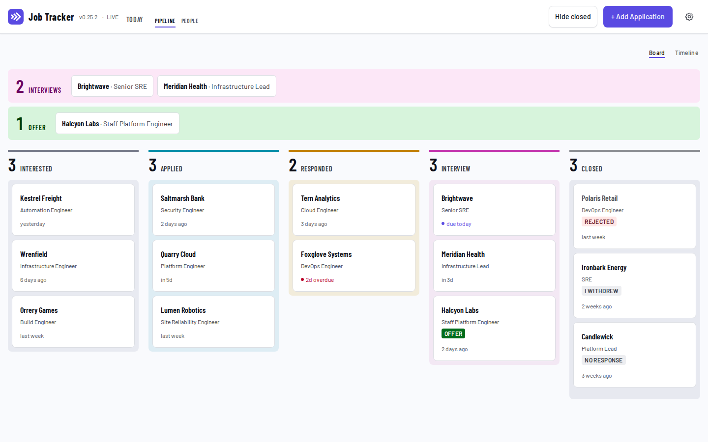

# Job Tracker

[](https://github.com/fergus/job-tracker/actions/workflows/build.yml)

**A self-hosted job tracker your AI agent can work.**

Connect Claude, or any MCP client, and it can tell you what you owe this week, log the call you just had, move the follow-up date, chase a recruiter and draft the cover letter. It works against your real pipeline, which lives in a SQLite file on your own server.

<picture>
  <source media="(prefers-color-scheme: dark)" srcset="docs/screenshot-dark.png">
  
</picture>

## What your agent can do

The built-in MCP server gives an agent the same reach you have in the browser:

- **Work the queue.** List what is overdue or due across roles, leads and people, then act on each item.
- **Keep the record.** Add stage notes, log an interaction with a recruiter, and set the next step and its date in the same call.
- **Manage the pipeline.** Create roles and leads, update them, close them with a reason, and link people to them.
- **Read your documents.** Pull plain text out of attached CVs, cover letters and job descriptions.
- **Draft.** Fetch the posting, extract the skills and salary, and draft a cover letter, CV tailoring notes or an interview prep brief from your profile.

Anything the agent changes shows up on the board straight away.

Full tool list: [docs/guide/mcp.md](docs/guide/mcp.md). An agent reading your pipeline sends what it reads to its model provider. **[What leaves your server](docs/guide/data-flows.md)** lists every outbound flow and how to turn each one off.

## What you get in the browser

- **Today:** everything you owe in the next seven days, grouped Overdue, Today and This week, with one-click snooze.
- **Pipeline:** a drag-and-drop board from Interested to Closed, an In play rail for interviews and offers, and a timeline of each role's stage history.
- **People:** recruiters, referrers and hiring managers, sorted by what you owe them. They can also sync to your iPhone Contacts.
- **The detail:** stage notes in markdown, attachments, salary ranges, links and editable stage dates.
- **Multi-user:** each person sees only their own data. Admins can view everything read-only.

How it all works: [docs/guide/using.md](docs/guide/using.md).

## Quick start

You need Docker with Compose 2.24+ and a private OIDC provider such as PocketID, Authentik, Authelia or Keycloak. Sign-in goes through oauth2-proxy, which accepts any email the provider vouches for, so never point it at a public provider like Google or GitHub. Details: [docs/guide/install.md](docs/guide/install.md#authentication).

**1. Get the files and configure:**

```bash
git clone https://github.com/fergus/job-tracker.git && cd job-tracker
cp .env.example .env
```

In your OIDC provider, create a client with redirect URI `https://your-domain.com/oauth2/callback`. Then fill in `.env`:

```env
OIDC_ISSUER_URL=https://auth.example.com
OIDC_CLIENT_ID=your-client-id
OIDC_CLIENT_SECRET=your-client-secret
PUBLIC_URL=https://your-domain.com
COOKIE_SECRET=          # openssl rand -base64 32 | tr -- '+/' '-_'
SERVER_API_KEY_SECRET=  # openssl rand -hex 32
```

**2. Start it** on the published image:

```bash
docker compose -f docker-compose.yml -f docker-compose.prod.yml up -d
```

Open `PUBLIC_URL` and sign in. The web app listens on port 3000 and the MCP server on port 3563. Put both behind your reverse proxy.

**3. Connect your agent.** Create an API key in **Settings → API keys**, then add this to `~/.mcp.json` for Claude Code (other MCP clients that support Streamable HTTP take the same URL and header):

```json
{
  "job-tracker": {
    "type": "http",
    "url": "https://your-domain.com/mcp",
    "headers": { "Authorization": "Bearer YOUR_API_KEY" }
  }
}
```

The URL is wherever your reverse proxy exposes port 3563. Then ask it: *"What do I owe this week?"*

## Guide

- [Install and operate](docs/guide/install.md): authentication, reverse proxy, updating, backups and configuration
- [Using Job Tracker](docs/guide/using.md): Today, follow-ups, the board, People and attachments
- [MCP server](docs/guide/mcp.md): connecting clients and the full tool list
- [What leaves your server](docs/guide/data-flows.md): every outbound data flow
- [People on your iPhone](docs/guide/iphone-contacts.md): read-only CardDAV address book
- [Architecture](ARCHITECTURE.md) and [Developing](DEVELOPING.md)

Built with Vue 3, Express 5 and SQLite, and shipped as a single Docker image.
