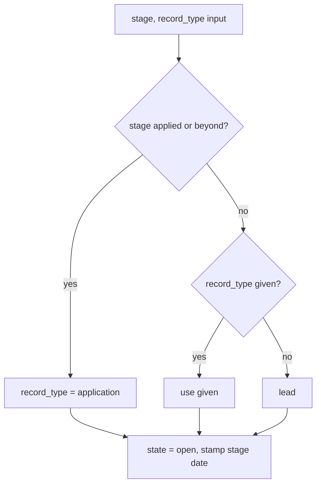

# Remove the Legacy Status Field - Plan

## Goal Capsule

- **Objective:** A record's position is described one way everywhere: stage, state, close reason and record type. REST, MCP and the web UI no longer expose or depend on the legacy `status`, and a close keeps its real reason.
- **Means:** Strip `status` at one outbound boundary, tombstone the removed surface for one release, rekey the board and panel on the split fields, and stop touching the column (KTD1, KTD3, KTD4).
- **Product authority:** The Product Contract below. Moving leads off the board, simplifying freshness sync and the record-page timeline (ideas 4, 6 and 7 of `docs/ideation/2026-09-28-ui-backend-simplification-ideation.html`) are not active scope.
- **Execution profile:** One breaking release. Units are ordered for implementation but ship together: the server stops emitting `status` in U1, so the client units (U6-U8) must land in the same release.
- **Stop conditions:** Stop and report if a production check shows an unclassified row, or if the MCP SDK cannot be made to reject a declared `status` argument (KTD3).
- **Open blockers:** None.

---

## Product Contract

### Summary

`status` is removed from the REST API, the MCP tools and the web UI in one breaking release. Agents change stage and close records with `update_application`. `update_status` and its REST route stay for one release as tombstones that fail with a clear message, and a passed `status` argument errors instead of being ignored. The board is keyed on stage, state and close reason, with one Closed column that shows each card's reason. The `status` column stays unused in the database and is dropped in the following release.

### Problem Frame

Stage, state, close reason and record type are authoritative, and a backfill applied on 2026-08-16 classified all 216 production rows. `status` is still written on every change, still drives the board, and collapses every non-acceptance close onto "rejected". REST, MCP and the UI each carry code to keep the two descriptions in step, plus fallback queries and a backfill block that production no longer needs.

Clients are exposed to the old field too. The suggested `fields` preset in the `list_applications` description names `status`, so a client that copied it depends on a lossy field. One MCP consumer already avoids `status` and filters on state, record type and follow-up state.

### Key Decisions

- **Remove `status` from API and MCP, with no deprecation window for its data.** (session-settled: user-directed - chosen over keeping it as a derived compatibility field: the user wants one model, and confirmed nothing outside the web client depends on it.) Governs R1, R2.
- **Tombstone the removed surface for one release.** (session-settled: user-directed - chosen over a bare removal: a clear error costs one release and stops a consumer from failing blind.) Governs R3, R4, R5.
- **One Closed column with a reason picker on drop.** (session-settled: user-directed - chosen over keeping Accepted and Rejected columns, and over closing as "rejected" on drop: the reason is a first-class fact now.) Governs R9, R10, R11, R12.
- **Create takes `stage` and `record_type` but not `state` or `close_reason`.** (session-settled: user-directed - chosen over adding state and close reason, or deferring: removes the create-then-update lead workaround.) Governs R6.
- **Stage wins on a create conflict.** (session-settled: user-directed - chosen over rejecting the conflict or letting `record_type` win.) Governs R6.
- **Stop using the `status` column now, drop it next release; roll back by restoring a pre-deploy backup.** (session-settled: user-approved - chosen over dropping it in the same release or keeping it written for an image rollback.) Governs R14, R15.
- **The panel keeps stage pills for the open stages and closes through the same reason picker as the board.** (session-settled: user-approved - chosen over keeping Accepted and Rejected pills: the panel and board then close records one way, and Accepted stays reachable as a close reason.) Governs R13, R19.

### Requirements

**API and MCP surface**
- R1. No REST or MCP response carries `status`, on list, get, create, update or the context endpoint.
- R2. A record's stage, state and close reason change only through `update_application` and `PUT /api/applications/:id`, with `stage`, `state` and `close_reason`.
- R3. The `update_status` MCP tool stays registered for one release; every call changes nothing and returns an error naming `update_application`.
- R4. `PATCH /api/applications/:id/status` returns 410 with the same message and changes nothing.
- R5. A `status` argument on list, create or update (REST query, body, or MCP argument) fails with an error naming the replacement fields; it is never silently ignored.
- R6. `create_application` and `POST /api/applications` accept `stage` (default `interested`) and `record_type`, and always create an open record. A stage of `applied` or beyond makes the record an application whatever `record_type` says; below `applied`, the given `record_type` is used, defaulting to `lead`.
- R7. In the same release, the `fields` preset and every tool description, README entry and AGENTS.md entry that names `status` or `update_status` are updated, and the tombstone is described as removed next release.
- R8. Closed records report their real `close_reason`; nothing reports a withdrawn, lapsed, role_closed, not_pursued or unresolved close as "rejected".
- R18. Writing a stage through `update_application` stamps that stage's date (`interested_at`, `applied_at`, `responded_at`, `interview_at`, `offer_at`) when the stage changes or a reopen lands on a stage with no date yet, so timeline data keeps filling in. `update_status` stamped on every write; the change-only rule is deliberate (KTD2).
- R20. Document-generation context describes a record by stage, state and close reason, not by `status`.

**Board**
- R9. Open records sit in stage columns keyed on stage and state: Interested, Applied, Responded, and Interview with Offer. No column reads `status`.
- R10. One Closed column replaces Accepted and Rejected, and each card shows its close reason. The recent-versus-older treatment of closed cards carries over to it.
- R11. Dropping a card on Closed opens a reason picker offering all seven close reasons. Choosing one closes the record with it; Escape cancels and the card returns to its column.
- R12. Dropping a closed card on an open stage column reopens it at that column's stage (the combined Interview with Offer column is defined in U7).
- R13. Every other client surface that read `status` (card signal, timeline, panel) reads stage, state and close reason instead.
- R19. In the application panel, the stage bar offers the open stages only; closing opens the board's reason picker; Undo after a stage change or close restores the previous stage, state and close reason through `update_application`.

**Data and rollout**
- R14. Nothing reads or writes the `status` column after this release, and the fallback queries that substituted it for unclassified rows are removed. The column stays in place untouched.
- R15. A database backup is taken immediately before deploy. Rollback is a restore of that backup, and the release notes say that redeploying the previous image is unsafe.
- R16. The one-shot status-split backfill block, its report output and the `SCHEMA_BACKFILL` compose variable are removed.
- R17. The following release removes the tombstones and drops the `status` column. This plan only commits to naming that follow-up.

**Product Contract preservation.** R1-R17 and AE1-AE7 are unchanged apart from R1 now naming the context endpoint. Planning added three requirements the brainstorm did not state, all found by reading the code: R18 (stage dates, resolves the first deferred question), R19 (panel behaviour, which R13 left open) and R20 (document-generation context). The Key Decision for the panel is user-approved at the planning checkpoint.

### Acceptance Examples

- AE1. **Covers R2, R5.** **Given** a client sends `update_application` with `state: closed` and `close_reason: withdrawn`, **when** the call succeeds, **then** the record is closed as withdrawn and no response includes `status`.
- AE2. **Covers R3, R4.** **Given** an old client calls `update_status` or `PATCH /api/applications/:id/status`, **when** the call arrives, **then** it gets the clear error or 410 and the record is unchanged.
- AE3. **Covers R5.** **Given** a client calls `GET /api/applications?status=applied`, **when** the request is handled, **then** it returns an error and not the full list.
- AE4. **Covers R6.** **Given** a create with `record_type: lead` and `stage: interview`, **when** it succeeds, **then** the record is an application at stage interview. **Given** `stage: interested` and `record_type: application`, **then** the record is an application at interested.
- AE5. **Covers R11.** **Given** a card dropped on Closed, **when** the user presses Escape on the picker, **then** no change is saved and the card returns to its original column.
- AE6. **Covers R12.** **Given** a closed card, **when** it is dropped on Responded, **then** the record is open at stage responded and its close reason is cleared.
- AE7. **Covers R8.** **Given** a record closed as role_closed, **when** any list or board surface shows it, **then** it reads role_closed and never "rejected".
- AE8. **Covers R18.** **Given** an application at applied, **when** `update_application` sets `stage: interview`, **then** `interview_at` is set and `applied_at` is unchanged.

### Success Criteria

- No code path in `server/` or `client/` reads or writes `status` except the tombstones, the shaping function and argument guards that reject it, and the untouched column.
- A repeat of the production check shows no open row without a stage and no closed row without a close reason after deploy.
- A consumer that used only the split fields needs no change to keep working.

### Scope Boundaries

- Leads stay on the board in Interested. Giving them their own place is a separate idea.
- Dropping the `status` column and removing the tombstones are the next release.
- Rewriting historical audit-log entries named `update_status` is not part of this work; the client keeps a display label for them.
- A reason or stage-date backfill for existing records is not needed: production rows are already classified.
- Consumers' own stale references (allowlists, prompt files) belong to those consumers.
- `create_application` accepting `state` or `close_reason` is deferred.
- Stage notes keep their own stage list, which includes accepted and rejected. It is a separate concept from a record's status and is not touched.

### Dependencies / Assumptions

- Production has the backfill applied (2026-08-16; 216 rows, none without stage, state or record type, none closed without a close reason).
- Only the web client and one agent consumer use the API, and that consumer already avoids `status`.
- A pre-deploy backup is a routine step the operator performs, as for the 2026-08-16 apply.

### Sources / Research

- `server/services/applications.js`: the status-to-triple mapping, the fallback SQL, the update and `updateStatus` paths.
- `server/db.js`: the `status_split_backfill` migration block.
- `server/mcp.js`: the `update_status` tool, the `fields` preset in the `list_applications` description, and the create schema.
- `client/src/components/KanbanBoard.vue`, `client/src/utils/timeline.js`, `client/src/utils/cardSignal.js`: the client users of `status`.
- `docs/plans/completed/2026-08-12-002-refactor-pipeline-schema-split-plan.md`: the split this finishes.
- `docs/ideation/2026-09-28-ui-backend-simplification-ideation.html`: idea 5.

---

## Planning Contract

### Key Technical Decisions

- KTD1. **One outbound shaping function strips `status` on every surface.** Rows are `SELECT *` decorated by `withFollowUp`, and `GET /api/applications/:id/context` returns the raw existing row, so each surface leaks the column independently. One function in `server/services/applications.js` removes `status` and every list, get, create, update, context and MCP path calls it. Chosen over selecting explicit columns: it keeps the `SELECT *` queries stable and has a single place to test. Covers R1, R14.
- KTD2. **Stage writes stamp their date on a stage change.** `updateApplication`'s stage and state path stamps only `closed_at` today, while `updateStatus` stamped the stage date through `STATUS_DATE_MAP` on every write, and the board's open-stage drag uses `updateStatus`. After removal the stage path stamps `interested_at`, `applied_at`, `responded_at`, `interview_at` or `offer_at` with the current time when the stage differs from the stored one, or when a reopen lands on a stage with no date yet. Reopening where it closed keeps the existing date, so Undo of a close loses nothing; any other same-stage write stamps nothing. Chosen over stamping every write: re-saving a stage would otherwise overwrite the date the timeline reads. Covers R18.
- KTD3. **A declared `status` parameter rejects loudly on MCP; REST checks explicitly.** The MCP SDK builds a zod object from the raw shape and may strip undeclared keys, so relying on it to reject would fail silently. The list, create and update tool schemas keep an optional deprecated `status` parameter whose handler throws a validation error naming `stage`, `state`, `close_reason` and `record_type`. REST handlers check `req.query` and `req.body` (including the multipart create) for `status` and reply 400 with the same message. A test proves the path through the real transport. Resolves the second deferred question. Covers R5.
- KTD4. **Tombstones are thin and share one message.** `update_status` stays registered with a loose schema (any `id` and `status`) and returns an `isError` result; `PATCH /api/applications/:id/status` returns 410. Both use one message constant naming `update_application` and saying the route is removed next release. Neither touches the database. Covers R3, R4.
- KTD5. **Create resolves the pair in one place.** `createApplication` computes `record_type` from `stage` and the given `record_type` (stage `applied` or beyond forces application; below, the given value, default lead), always inserts `state = open` and omits `status` from the insert, which the column default covers (`NOT NULL DEFAULT 'interested'` in `server/db.js`). The shared stage-to-date map from KTD2 stamps the creation date for the starting stage. Covers R6.
- KTD6. **Split the status list from the note-stage list.** `VALID_STATUSES` is also the validation list for stage notes in `server/services/notes.js`, which accepts accepted and rejected. It is renamed for that purpose and kept; application stage validation uses the stage list that already exists for the split fields, or a new one if none does. Deleting `VALID_STATUSES` would break stage notes. Covers R14.
- KTD7. **`fields` naming `status` is tolerated.** A `fields` projection that includes `status` returns records without it (the projection already drops unknown names) rather than an error. This is the one place a stale `status` is not loud, because `fields` is a projection and the suggested preset itself is being corrected (R7). Recorded so a reader does not read it as a gap in R5.
- KTD8. **The panel and board share one close-reason picker.** The shared module exports the full seven-reason list including `accepted`, extracted from `CLOSE_REASONS` and `CLOSE_REASON_LABELS` in `client/src/utils/timeline.js`; the panel's current `closeReasonOptions` filters `accepted` out because it was reached through the Accepted stage pill, and that filter goes when the panel adopts the picker. The list lives in a shared module and a `CloseReasonPicker` component used by both surfaces. Undo restores the pre-change stage, state and close reason with `updateApplication`. (session-settled: user-approved - chosen over keeping Accepted and Rejected pills: one way to close a record, Accepted stays reachable as a reason.) Governs R11, R13, R19; inherits the label from the panel Key Decision.
- KTD9. **Reopen is a state write.** Dropping a closed card on an open column and choosing an open stage in the panel both call `updateApplication` with `state: open` and the target stage. U2 confirms the service clears `close_reason` and `closed_at` on reopen and adds that if it does not. Covers R12.
- KTD10. **Backfill code goes with the fallbacks.** With production verified fully classified, `services/migration-backfill.js`, `deriveRecord`, `tripleFromStatus`, `statusFromTriple`, `evidencesApplication`, the `EFFECTIVE_STATE_SQL` and `EFFECTIVE_RECORD_TYPE_SQL` COALESCE fallbacks and the old screening-to-responded migration are deleted. The migration marker row `status_split_backfill` stays in `_migrations` harmlessly. Covers R14, R16.
- KTD11. **Rollback is an operator step.** No migration, no schema change and no tooling: the release notes and the fs-release deploy step name the pre-deploy backup and say that redeploying the old image is unsafe because it would read a `status` column that stopped being written. Covers R15.

### High-Level Technical Design

Directional only; names are illustrative.

Where `status` was read or written today and what replaces it:

| Layer | Before | After |
|---|---|---|
| REST responses | raw row incl. `status` | shaped row (KTD1) |
| Stage change | `PATCH /:id/status` -> `updateStatus` | `PUT /:id` with `stage` (KTD2) |
| Close | `updateStatus` to rejected/accepted, or `updateApplication` with reason | `updateApplication` with `state` and `close_reason` |
| Create | `status` -> triple via mapping | `stage` + `record_type` (KTD5) |
| Board columns | key on `a.status` | key on `stage`, `state`, `close_reason` |
| Panel pills | seven statuses | five stages + Close (KTD8) |

Create resolution (KTD5):

### Risks and Dependencies

- **Client and server must ship together.** The server stops emitting `status` in U1; an older cached client would render an empty board. The web client is served by the same image, so one deploy covers it, but a browser tab open across the deploy needs a reload. Note it in the release notes.
- **Stage-date regression.** If U2 misses KTD2, every board drag after release leaves timeline dates unset with no error. AE8 and a board-level e2e check guard it.
- **Silent MCP argument stripping.** KTD3 exists because of it; a test over the real transport is required, not a unit test of the handler alone.
- **Breaking release.** The consumer of the MCP server is described as already status-free, but this is not verified from its side; the tombstone is the safety net.
- **Playwright e2e.** Eight specs touch status (views, kanban, kanban-drag, today, people-view, settings, contact-panel, follow-up-date). They are rewritten, not deleted; the first full run is the real signal for U7-U8.

---

## Implementation Units

| U-ID | Title | Key files | Depends on |
|---|---|---|---|
| U1 | Outbound shaping and read-side cleanup | `server/services/applications.js`, `server/services/today.js`, `server/routes/applications.js`, `server/services/generation.js` | - |
| U2 | Write path: create, stage dates, remove status writes | `server/services/applications.js`, `server/services/notes.js` | U1 |
| U3 | REST tombstone and status rejection | `server/routes/applications.js` | U1, U2 |
| U4 | MCP tools, descriptions and audit | `server/mcp.js` | U1, U2 |
| U5 | Remove the backfill | `server/db.js`, `server/services/migration-backfill.js`, `docker-compose.yml` | U1, U2 |
| U6 | Client data layer and derived utils | `client/src/api.js`, `client/src/utils/*` | U1 |
| U7 | Board: columns, Closed, picker, drops | `client/src/components/KanbanBoard.vue`, `client/src/App.vue` | U6 |
| U8 | Application panel | `client/src/components/ApplicationPanel.vue` | U6, U7 |
| U9 | Docs and release notes | `README.md`, `AGENTS.md`, `.claude/skills/fs-release/SKILL.md` | U1-U8 |

### U1. Outbound shaping and read-side cleanup

- **Goal:** No server response carries `status`, and no read depends on the column.
- **Requirements:** R1, R8, R14, R20. Covers AE7.
- **Files:** `server/services/applications.js`, `server/services/today.js` (imports and interpolates `EFFECTIVE_STATE_SQL` and `EFFECTIVE_RECORD_TYPE_SQL`), `server/routes/applications.js` (the `/:id/context` handler), `server/services/generation.js` (line `Status: ${app.status}`), `server/test/services/applications.test.js`, `server/test/today.test.js`, `server/test/api.test.js`.
- **Approach:** Add the KTD1 shaping function and apply it in list, get, create, update, the context handler and wherever else `withFollowUp` output leaves the service. Replace the list filter on `a.status` and the `EFFECTIVE_*_SQL` fallbacks (KTD10) with direct reads of stage, state and record type. Repoint `today.js` to read `a.state` and `a.record_type` directly before the constants are deleted, and move its fixtures from `status` to stage and record type. Switch `generation.js` to stage, state and close reason lines.
- **Execution note:** Characterize current list filtering on stage, state and record type before removing the fallbacks, so the rewrite is proven behaviour-preserving.
- **Test scenarios:**
  - List, get, create and update responses contain no `status` key; the context endpoint's `existing` row has none either.
  - A record closed as role_closed lists with `close_reason: role_closed` and nothing in the response reads "rejected" (AE7).
  - List filters by `stage`, `state` and `record_type` return the same rows as before on a seeded set including closed and lead rows.
  - The Today queue returns the same open leads and applications as before on the seeded set.
  - Generation context for a closed application names stage, state and close reason and contains no `Status:` line.
- **Verification:** `cd server && npm test` green for the touched files; `rg -n "\.status\b" server/services/applications.js` shows no application-status reads.

### U2. Write path: create, stage dates, remove status writes

- **Goal:** Creates and updates use only the split fields, and stage changes stamp their dates.
- **Requirements:** R2, R6, R14, R18. Covers AE4, AE6, AE8.
- **Files:** `server/services/applications.js` (`createApplication`, `updateApplication`, `updateStatus`, `STATUS_DATE_MAP`, `tripleFromStatus`, `statusFromTriple`, `evidencesApplication`, `deriveRecord` import), `server/services/notes.js`, `server/test/services/applications.test.js`, `server/test/services/notes.test.js`, `server/test/services/stage-notes.test.js`.
- **Approach:** Follow KTD2, KTD5, KTD6, KTD9, KTD10. Replace `STATUS_DATE_MAP` with a stage-keyed date map used by create, update and reopen. Delete `updateStatus` and the triple mapping helpers and drop `status = ?` from the update block. Rename `VALID_STATUSES` for its note-stage use and repoint `notes.js`; validation of application `stage` uses the stage list. Confirm reopen clears `close_reason` and `closed_at`; add that if missing.
- **Test scenarios:**
  - Create with `stage: interview, record_type: lead` yields an application at interview with `interview_at` set (AE4); create with `stage: interested, record_type: application` yields an application at interested; create with no `record_type` below applied yields a lead; create never yields a closed record.
  - Update `stage: interview` on an applied record sets `interview_at` and leaves `applied_at` untouched (AE8); a same-stage update stamps nothing.
  - Reopen: a closed record updated to `state: open, stage: responded` is open at responded, `close_reason` and `closed_at` cleared, `responded_at` stamped (AE6).
  - Closing with each of the seven close reasons stores that reason and stamps `closed_at`.
  - Stage notes still accept `accepted` and `rejected` stages and reject an unknown stage.
  - The inserted row's `status` column holds its default and is never updated by later writes.
- **Verification:** `cd server && npm test`; `rg -n "status" server/services/applications.js` shows only the column default context and the shaping function.

### U3. REST tombstone and status rejection

- **Goal:** The removed REST surface fails clearly.
- **Requirements:** R4, R5. Covers AE2, AE3.
- **Files:** `server/routes/applications.js`, `server/test/api.test.js`.
- **Approach:** Per KTD3 and KTD4: replace the `PATCH /:id/status` handler with the 410 tombstone; add a shared check that rejects `status` in the query of the list route and the body of create and update (JSON and multipart), using the repo's validation-error path for a 400 that names the replacement fields.
- **Test scenarios:**
  - `PATCH /api/applications/:id/status` returns 410 with the message naming `update_application`, and the record is unchanged afterwards (AE2).
  - `GET /api/applications?status=applied` returns 400 naming `stage`, `state`, `close_reason` and `record_type`, not a list (AE3).
  - `POST` (JSON and multipart) and `PUT /:id` carrying `status` return 400 and create or change nothing.
  - Requests without `status` behave as before.
- **Verification:** `cd server && npm test`.

### U4. MCP tools, descriptions and audit

- **Goal:** The MCP surface speaks only the split fields and fails loudly on the old ones.
- **Requirements:** R3, R5, R6, R7. Covers AE1, AE2, AE4.
- **Files:** `server/mcp.js`, `server/test/mcp.test.js`, `server/test/api.test.js` (real-transport coverage).
- **Approach:** Follow KTD3 and KTD4. Replace the `status` enum in the create schema with `stage` and `record_type`; keep a declared optional `status` on list, create and update that throws; turn `update_status` into the tombstone with the shared message. Fix the `fields` preset in the `list_applications` description, every tool description that names `status`, and the audit log detail lines. Historical `update_status` audit entries are untouched.
- **Test scenarios:**
  - Over the real MCP transport, `update_application` with `state: closed, close_reason: withdrawn` closes the record and the returned record has no `status` (AE1).
  - `update_status` returns an error result naming `update_application` and the record is unchanged (AE2).
  - `list_applications`, `create_application` and `update_application` called with `status` return an error naming the replacement fields, proven through the transport so SDK argument stripping cannot mask it.
  - `create_application` with `stage` and `record_type` follows R6 (AE4); `fields` including `status` returns records without it (KTD7).
  - The advertised tool list still contains `update_status`, and no description contains the removed preset text.
- **Verification:** `cd server && npm test`.

### U5. Remove the backfill

- **Goal:** The one-shot backfill and everything that existed only for it are gone.
- **Requirements:** R14, R16.
- **Files:** `server/db.js` (the `status_split_backfill` block and the screening-to-responded one-shot), `server/services/migration-backfill.js` (delete), `server/test/migration-backfill.test.js` (delete), `server/test/status-split.test.js` (delete or fold surviving cases into the applications tests), `server/test/schema.test.js`, `docker-compose.yml` (`SCHEMA_BACKFILL`), `AGENTS.md` if it names the variable.
- **Approach:** Delete the block and module per KTD10, leave the `status` column definition and the `_migrations` marker row alone, and remove the compose variable and its comment.
- **Test scenarios:**
  - A fresh database and an existing database both start without the backfill and without errors; the `status` column still exists.
  - `schema.test.js` no longer asserts on backfill behaviour and still asserts the schema it should.
  - Any status-split behaviour worth keeping (classification of closed and lead rows) is covered by the applications tests from U1-U2, not lost with the deleted file.
- **Verification:** `cd server && npm test`; `rg -n "SCHEMA_BACKFILL|migration-backfill|deriveRecord" server docker-compose.yml AGENTS.md` returns nothing.

### U6. Client data layer and derived utils

- **Goal:** Client helpers read stage, state and close reason and call the new write path.
- **Requirements:** R8, R13. Covers AE7.
- **Files:** `client/src/api.js`, `client/src/utils/cardSignal.js`, `client/src/utils/timeline.js`, `client/src/utils/closedPartition.js`, their `*.test.js` files, `client/src/components/KanbanCard.vue`, `client/src/components/TimelineView.vue`.
- **Approach:** Remove `updateStatus` and the `fetchApplications(status)` parameter from `api.js`. Rewrite `STALE_STAGES.has(application.status)` in `cardSignal.js`, the `isTerminal`, `isRejected`, `isAccepted` fallbacks and `computeSegments` in `timeline.js`, and the `application.status === 'offer'` check in `KanbanCard.vue` over stage, state and close reason. `TimelineView.vue` groups, sorts and styles by stage (the `--stage-*` CSS variable) and the aria label uses stage and close reason.
- **Test scenarios:**
  - `cardSignal` marks stale open applications in the same stages as before and ignores closed records.
  - `timeline` segments for an application that went interested to interview to closed (withdrawn) match the previous output, and a closed-accepted record is distinguished from a closed-rejected one by reason.
  - `KanbanCard` shows the offer treatment for stage offer and not for a closed record.
  - `closedPartition` splits recent and older closed records unchanged.
- **Verification:** `cd client && npm run test:unit`, `npm run lint`.

### U7. Board: columns, Closed, picker, drops

- **Goal:** The board is keyed on the split fields with one Closed column and a reason picker.
- **Requirements:** R9, R10, R11, R12, R13. Covers AE5, AE6, AE7.
- **Files:** `client/src/components/KanbanBoard.vue`, `client/src/components/CloseReasonPicker.vue` (new), `client/src/utils/closeReasons.js` (new, extracted list), `client/src/App.vue` (`handleStatusChange`, `handleCloseRecord`, the `@status-change` binding), `client/e2e/kanban.spec.js`, `client/e2e/kanban-drag.spec.js`, `client/e2e/views.spec.js`, `client/e2e/today.spec.js`.
- **Approach:** Follow KTD8, KTD9. Columns key on stage and state; the Accepted and Rejected zones and their drop-zone test ids are replaced by one Closed column that reuses the `closedPartition` treatment and shows a reason badge per card, on desktop and the mobile closed group. A drop on Closed opens the picker (focus trapped, Escape snaps the card back); a drop on an open column calls `updateApplication` with the target stage and `state: open`. The combined Interview with Offer column writes the card's current stage when it is already interview or offer and `interview` otherwise, so reordering an offer card never demotes it; reaching offer is done from the panel stage bar. `App.vue` replaces `handleStatusChange` with a stage-change handler that keeps the Undo toast by restoring the previous stage, state and close reason.
- **Test scenarios:**
  - Unit or component: the picker lists all seven reasons, selecting one emits it, Escape emits cancel.
  - e2e: drag an Interested card to Applied; it moves and the record's `applied_at` is set (guards KTD2).
  - e2e: drag a card to Closed, pick Withdrawn; the card sits in Closed with a withdrawn badge and is not labelled rejected (AE7).
  - e2e: drag to Closed and press Escape; the card returns to its original column and nothing is saved (AE5).
  - e2e: drag a closed card to Responded; it is open at responded and the badge is gone (AE6).
  - e2e: dragging an offer card within the Interview with Offer column leaves it at offer; dragging a closed card there reopens it at interview.
  - e2e: Undo after a stage change and after a close restores the prior column and reason.
  - Mobile layout: the closed group still renders and shows reasons.
- **Verification:** `cd client && npm run lint && npm run build`, then `npm run test:e2e` for the kanban, kanban-drag, views and today specs.

### U8. Application panel

- **Goal:** The panel changes stage and closes records without `status`.
- **Requirements:** R13, R19, R6. Covers AE5, AE7.
- **Files:** `client/src/components/ApplicationPanel.vue` (pill bar and `statuses` const, `onStatusClick`, `form.status`, the create `FormData`, the note-stage select, the audit label for `update_status`), `client/e2e/people-view.spec.js`, `client/e2e/settings.spec.js`, `client/e2e/contact-panel.spec.js`, `client/e2e/follow-up-date.spec.js`.
- **Approach:** Follow KTD8. The pill bar renders the five open stages and a Close action that opens `CloseReasonPicker`. A closed record shows no active stage pill and a visible closed-with-reason indicator; clicking an open stage pill reopens it at that stage (KTD9); Close on a closed record opens the picker preselected with the current reason. The Outcome section's standalone close-reason select is removed in favour of the picker. Create mode adds a lead/application toggle (default lead) beside the starting-stage pills, and a starting stage of applied or beyond sets it to application, matching R6. Create sends `stage` and `record_type`, never `status`. The note-stage select gets its own list including accepted and rejected (KTD6). Keep a display label for historical `update_status` audit entries.
- **Test scenarios:**
  - Clicking a stage pill changes the stage; Undo restores the previous stage, state and close reason.
  - Close opens the picker; choosing Accepted closes the record with reason accepted; Escape leaves it unchanged.
  - A closed record reopens from a stage pill, and Close on it lets the reason be changed.
  - Creating a lead and an application from the panel sends no `status` and produces the expected record type and stage.
  - The note-stage select still offers accepted and rejected.
  - A historical `update_status` audit entry still renders with its label.
- **Verification:** `cd client && npm run lint && npm run build`, then the touched e2e specs.

### U9. Docs and release notes

- **Goal:** Every document and description tells the new story, and the operator knows the rollout.
- **Requirements:** R7, R15, R17.
- **Files:** `README.md` (the `update_status` tool entry), `AGENTS.md` (the lines naming status, `update_status`, the route and the backfill), `.claude/skills/fs-release/SKILL.md` (a pre-deploy backup step), `docker-compose.yml` comments.
- **Approach:** Replace every `status` and `update_status` description with the split-field model and a one-line tombstone note (removed next release); document that `create_application` takes `stage` and `record_type`; name the Closed column and reason picker where UI is described. Add to the fs-release deploy step a database backup immediately before `up -d --build`, with the restore command, and write the release notes (breaking change, tombstones, reload after deploy, rollback is restore not redeploy).
- **Test expectation:** none -- documentation only.
- **Verification:** `rg -n "update_status|status" README.md AGENTS.md` leaves only the tombstone and the stage-note references; the release notes mention R15's warning.

---

## Verification Contract

| Gate | Command | Applies to |
|---|---|---|
| Server tests | `cd server && npm test` | U1-U5 |
| Client unit tests | `cd client && npm run test:unit` | U6-U8 |
| Lint | `cd client && npm run lint` (and the server lint if the repo has one) | all |
| Build | `npm run build:client` | U6-U8 |
| End-to-end | `cd client && npm run test:e2e` (needs `npx playwright install chromium` once) | U7, U8 |
| Leftover scan | `rg -n "\bstatus\b" server client/src` reviewed: only the tombstones, the shaping function, the `status` argument guards, the column default, and the stage-note list may remain | all |
| Pre-deploy check | on the live database before deploying: no row without stage, state or record type, no closed row without a close reason (once the fallbacks go, such a row would drop out of filters silently) | rollout |
| Production check | repeat the 2026-08-16 checks on the live database after deploy: no open row without a stage, no closed row without a close reason | rollout |

Tests are the primary quality gate: every existing server and e2e test that used `status` is rewritten to the new shape, not deleted, and the new tests above cover the tombstones, the loud failures, the create conflict rule, stage-date stamping and the board's reason picker.

## Definition of Done

- All Requirements R1-R20 are met and AE1-AE8 each have a passing test.
- Server tests, client unit tests, lint, build and the full e2e suite pass.
- The leftover scan finds no read or write of `status` outside the tombstones, the shaping function, the argument guards, the untouched column and the stage-note list.
- Backfill code, the compose variable and the deleted tests are gone; no abandoned experimental code remains in the diff.
- Docs and tool descriptions are updated, and release notes state the breaking change, the tombstones, the browser reload and the restore-only rollback.
- A database backup was taken immediately before deploy, the deployed container reports the new version, and the production check passes.
- The follow-up (remove the tombstones, drop the `status` column) is recorded as a todo.
