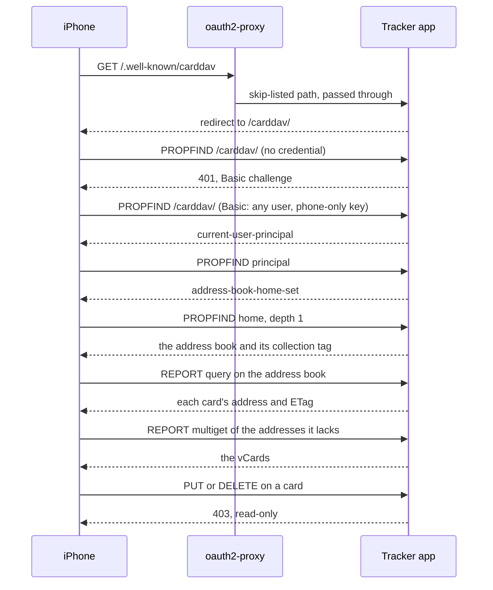

# iPhone Contacts Sync - Plan

## Goal Capsule

- **Objective:** The people in the tracker's People list who have an email or phone number, with their email, phone and LinkedIn link where set, are available in the iPhone Contacts app as an account of their own, apart from the user's Outlook and iCloud contacts.
- **Means:** A read-only CardDAV address book served by the tracker and unlocked by a phone-only key (KTD1, KTD2).
- **Product authority:** The user (fergus). Backfilling LinkedIn URLs for existing people is not active scope; the user does it separately on their own instance.
- **Authority order for conflicts:** Product Contract requirements win on behavior; Key Technical Decisions win on mechanism within them.
- **Stop conditions:** Stop and ask if a real iPhone cannot add the account after U5 passes its contract tests, or if serving the address book needs a change to the oauth2-proxy skip list beyond the two entries named in KTD4.
- **Execution profile:** Code. The implementer finishes server and client work, tests and docs; the user performs the one-time iPhone check and the compose redeploy.
- **Open blockers:** None.

---

## Product Contract

**Product Contract preservation:** changed: R7 and the credential Key Decision (the phone credential is now a dedicated phone-only key rather than an existing full-access key; confirmed at the planning synthesis), plus new R10 split out of R7 for the key's limits. All other R, F and AE IDs unchanged; AE2 and R1 intact.

### Summary

A read-only contacts account for the iPhone mirrors the People list. Each person with an email or phone number gets a card with name, role, employer, email, phone, LinkedIn link and a link back to them in the tracker. People gain an optional LinkedIn URL field, editable in the tracker and filled automatically when a connection is promoted.

### Problem Frame

The People list holds the recruiters, referrers and hiring managers the user is chasing, but their email, phone and LinkedIn link exist only inside the tracker. When one of them calls, or the user needs to message them, those details are not on the phone.

The user does not want these people mixed into their Outlook or iCloud contacts. Those hold personal and work contacts, and search-related people would clutter them and be hard to separate again.

### Key Decisions

- **The phone gets a read-only copy; the tracker stays the source of truth.** Two-way sync is deferred, not ruled out. (session-settled: user-directed — chosen over two-way now: the user wants read-only first and write-back later.) Governs R6.
- **Only People with an email or phone appear; imported LinkedIn connections do not.** A promoted connection is a person, so it follows the same rule and stays off the phone until it has an email or phone, which promotion does not always supply. (session-settled: user-directed — chosen over syncing connections, only open follow-ups, or letting a LinkedIn link alone qualify: keeps the phone list small and relevant.) Governs R1, R3.
- **LinkedIn link is a new field on a person.** (session-settled: user-directed — chosen over taking it only from promoted connections or fuzzy name matching: fuzzy matching can attach the wrong profile.) Governs R8, R9.
- **Cards carry role and employer and a link back to the tracker, and nothing from notes or follow-ups.** (session-settled: user-directed — chosen from the offered card fields.) Governs R2.
- **The phone account authenticates with a dedicated phone-only key the user creates in Settings, entered as the account password.** The browser sign-in cannot be used from a phone contacts account, and the phone offers only a username and password. (session-settled: user-approved — chosen over reusing a full-access API key: a key on a lost phone then cannot reach applications or notes.) Governs R7, R10.

### Requirements

**Who appears on the phone**

- R1. Every person in the user's People list who has an email or a phone number appears on the phone; a person with neither does not.
- R2. A card shows the person's name, role, employer, email, phone, LinkedIn link, and a link that opens the person in the tracker.
- R3. Imported LinkedIn connections that have not been promoted never appear.
- R4. When the user adds, edits or deletes a person in the tracker, or clears both their email and phone, the phone reflects it the next time it refreshes.

**The phone account**

- R5. The people appear in the iPhone Contacts app as their own account, separate from the user's Outlook and iCloud accounts, and nothing is written into those accounts.
- R6. The phone cannot change the tracker. Edits or additions made to cards on the phone are not written back.
- R7. The account is set up in the phone's standard account screen, using a phone-only key the user creates in the tracker's Settings as the password. It exposes only that user's own people and works without the browser sign-in.
- R10. The phone-only key opens this account and nothing else, and the user can revoke it from Settings.

**LinkedIn link**

- R8. A person has an optional LinkedIn URL that the user can set, change and clear in the tracker's web UI, and through the REST API and MCP contact tools.
- R9. Promoting a LinkedIn connection to a person sets the LinkedIn URL from the connection's profile URL.

### Key Flows

- F1. Connect the phone
  - **Trigger:** The user wants their People list on the iPhone.
  - **Steps:** The user creates a phone-only key in Settings; adds a contacts account on the iPhone using the address and key the tracker shows; the cards appear under that account.
  - **Outcome:** The people are listed in Contacts under their own account.
  - **Covers:** R1, R2, R5, R7

- F2. A change reaches the phone
  - **Trigger:** The user edits a person, adds one, or deletes one in the tracker.
  - **Steps:** The change is saved; the phone refreshes; the card appears, changes or disappears.
  - **Outcome:** The phone matches the People list.
  - **Covers:** R1, R4

### Acceptance Examples

- AE1. **Covers R1, R4.** Given a person with only a phone number, when the phone refreshes, a card appears. When the user then clears that number, the card disappears on the next refresh.
- AE2. **Covers R1, R3, R9.** Given an imported connection, it does not appear on the phone. When the user promotes it, the person carries the connection's LinkedIn profile URL, and a card appears if the person has an email or phone. Without either, there is no card until the user adds one.
- AE3. **Covers R6.** Given a card on the phone, when the user edits it there, the person in the tracker is unchanged.
- AE4. **Covers R5.** Given Outlook and iCloud contacts, after setup their contents are unchanged and the tracker's people appear only under their own account.
- AE5. **Covers R10.** Given a phone-only key, when it is used as a Bearer token against the REST API or MCP it is refused; when the user revokes it in Settings, the phone account stops syncing.

### Success Criteria

- The user can find a person's number, email and LinkedIn link on the iPhone without opening the tracker.
- Nothing from the tracker shows up in the user's Outlook or iCloud contacts.

### Scope Boundaries

**Deferred for later**

- Two-way sync: edits and new contacts made on the phone written back to the tracker.
- Follow-up dates, next actions or notes on the card.

**Outside this work**

- Backfilling LinkedIn URLs for people already in the tracker. The user does this separately on their own instance; this work only needs the field to be writable (R8).
- Syncing imported LinkedIn connections that have not been promoted.
- Support for contact apps other than the iPhone Contacts app. Other apps may work but are not designed or tested for.

**Considered and not built**

- Incremental sync of only changed cards. The People list is small and the whole list is re-read when anything changes; revisit if the list grows into the thousands.
- Photos on cards. Nothing in the tracker holds one.
- Removing the `LinkedIn: <url>` line that promotion already writes into a person's notes. It is harmless, and the user's separate backfill may read it.

### Dependencies / Assumptions

- The phone needs a route to the tracker that does not go through the browser sign-in. KTD4 picks it.
- iOS may visually link a card here with a matching Outlook or iCloud card in its combined "All Contacts" view. The accounts stay separate; this is accepted.

### Outstanding Questions

**Deferred to Implementation**

- How soon a tracker change shows on the phone. iOS decides when a contacts account refreshes, so R4 and AE1 depend on a refresh interval the tracker does not control. The manual iPhone check records the observed behavior in the docs.
- Which properties a current iOS asks for when it adds the account. The contract tests encode the request sequence in the High-Level Technical Design; a real device may ask for more, which U5 absorbs.
- Whether a current iOS needs the `/.well-known/carddav` redirect to be a 301 or a 308. Either satisfies U5; the manual check records which works.

### Sources / Research

- `server/db.js` (`contacts` table): a person has name, role, employer, email, phone and notes, and no LinkedIn field. `contacts.source_connection_id` records which connection a person was promoted from. `api_keys` holds `user_email`, `label`, `key_hash`, `last_used_at`.
- `server/services/connections.js` (`promoteConnection`): promotion copies name, position, company and email into a contact and writes the profile URL into notes. It does not copy a phone number, because connections have none.
- `server/lib/apiKeySecret.js` (`resolveApiKey`) and `server/middleware/auth.js`: two separate key lookups. MCP calls `resolveApiKey`; REST Bearer auth repeats the HMAC inline and queries the key table directly, so a scope check has to land in both.
- `server/middleware/auth.js`, `server/app.js`: `/api` sits behind `authMiddleware`; `/upload` is mounted before it with its own credential. That is the precedent for a route that authenticates itself.
- `docker-compose.yml` (`OAUTH2_PROXY_SKIP_AUTH_ROUTES`): the regex that lets a path bypass the browser sign-in.
- `AGENTS.md` (Tables, API Conventions, Auth and Security, MCP Server): schema, conventions and the tool list this work extends.

---

## Planning Contract

### Key Technical Decisions

- KTD1. **Serve the phone account as a read-only CardDAV address book.** iOS adds a third-party contacts account only over CardDAV, and a CardDAV account is what keeps the people apart from Outlook and iCloud. A one-off `.vcf` import lands in the default account and a subscribed `.vcf` URL is not a contacts feature on iOS. Governs R5, R6. Any write method is refused.
- KTD2. **A phone-only key is an `api_keys` row with a `scope` of `contacts`; null scope stays a full-access key.** Bearer REST auth and MCP refuse scoped keys, and only the CardDAV routes accept them. (session-settled: user-approved — chosen over reusing a full-access key: a key on a lost phone then cannot reach applications or notes.) Governs R7, R10. The existing 20-key cap and Settings revoke apply unchanged.
- KTD3. **The phone sends the key as the HTTP Basic password; the username is ignored.** The lookup is the same HMAC match `resolveApiKey` already performs, so no second credential scheme exists. Governs R7. The address book is only safe over HTTPS, so the docs say so.
- KTD4. **CardDAV mounts on the existing app under `/carddav/`, before `authMiddleware`, with a `/.well-known/carddav` redirect, and both join the oauth2-proxy skip list in `docker-compose.yml` as `carddav(/.*)?` and `\.well-known/carddav` inside its existing anchored group.** The list is one end-anchored pattern, so a bare `carddav` would match only that exact path and leave every subpath behind the browser sign-in. The redirect is a 301 or 308, so the phone keeps its request method. The routes authenticate themselves per KTD3, as `/upload` does. A separate port, as MCP uses, would avoid the compose edit but needs a new mapping in the user's own reverse proxy that this repo cannot hold. Governs R7.
- KTD5. **The protocol subset is hand-written with no new dependency.** The phone needs only discovery, listing and reading, so responses are built from templates, and the one request body parsed for content is a multiget's list of hrefs. Writes and unsupported methods are refused with the allowed methods named. Governs R5, R6.
- KTD6. **Cards are vCard 3.0, one per eligible person, with a content-hash ETag and a collection tag hashed from all ETags.** Any change to a card, an add, or a delete changes the collection tag, so the phone re-reads, and an edit that changes nothing shown does not. The card UID is stable per person, and the card carries no revision stamp, so nothing but shown content moves its ETag. Governs R2, R4.
- KTD7. **Eligibility is one function, and the address book reads only the `contacts` table.** A person qualifies when email or phone is non-empty after trimming. Imported connections live in another table, so R3 holds without a filter. Governs R1, R3.
- KTD8. **The link back is `<PUBLIC_URL>/?contact=<id>`, and the web app opens that person's panel on load.** When `PUBLIC_URL` is unset the base is the scheme and host of the CardDAV request itself, which is the address the phone already reaches the tracker on, so every card carries the link. Governs R2.
- KTD9. **`linkedin_url` is a nullable column on `contacts`, validated as an `http` or `https` URL of at most 500 characters, with empty input stored as null.** The host is not restricted to linkedin.com. A non-web scheme would become a clickable `javascript:` link in the panel and a bad URL property on the card, so it is refused. Governs R8, R9.

### High-Level Technical Design

The phone walks a fixed discovery path before it lists cards. The contract tests in U5 replay this sequence.

### Assumptions

- A current iOS adds a read-only CardDAV address book that answers the paths above and refuses writes; it may probe a property or two beyond them. U5 and the manual check confirm this.
- The People list stays small enough (hundreds) that building every card on each request is fine.

---

## Implementation Units

### U1. LinkedIn URL on a person, through the API and MCP

- **Goal:** A person carries an optional validated LinkedIn URL that REST, MCP and connection promotion all read and write.
- **Requirements:** R8, R9
- **Dependencies:** none
- **Files:** `server/db.js`, `server/services/contacts.js`, `server/services/connections.js`, `server/mcp.js`, `server/test/contacts.test.js`, `server/test/connections.test.js`, `server/test/mcp.test.js`, `server/test/schema.test.js`
- **Approach:**
  - Add the column with the same `PRAGMA table_info` guard the next-touch columns use in `server/db.js`.
  - Add the field to `EDITABLE_FIELDS` and `LIMITS` in `server/services/contacts.js`, and validate per KTD9 on create and update. An explicit null or empty string clears it.
  - Pass `linkedin_url` from the connection's `url` in `promoteConnection` only when it passes the KTD9 validator; otherwise promote with it null so a malformed imported URL never blocks promotion. The notes line stays as it is.
  - Add the field to `create_contact`, `update_contact` and `convert_application_to_contact` in `server/mcp.js`, with the null-clears semantics `update_contact` already documents.
- **Patterns to follow:** the `phone` field in `server/services/contacts.js` and the `contactCols` migration loop in `server/db.js`.
- **Test scenarios:**
  - Covers AE2. Promoting a connection yields a contact whose `linkedin_url` equals the connection's profile URL, and promoting it again reuses that contact with the URL unchanged.
  - A contact created with `https://www.linkedin.com/in/jane` returns it, and updating with `null` clears it.
  - An empty string clears the field instead of storing an empty string.
  - A value of `javascript:alert(1)` is refused with 400, as is `ftp://x`, and a value over 500 characters is refused.
  - Promoting a connection whose imported URL is not `http` or `https` still creates the person, with `linkedin_url` null.
  - Another user's contact cannot be updated with a LinkedIn URL (404), as for every other field.
  - `create_contact` and `update_contact` over MCP accept and return `linkedin_url`.
  - A database created before this change gains the column on startup with existing contacts reading null.
- **Verification:** the new tests pass and existing contact, connection and MCP tests still pass.

### U2. LinkedIn field and open-from-link in the web app

- **Goal:** The user edits a person's LinkedIn URL in the panel, and a `?contact=<id>` link opens that person.
- **Requirements:** R2, R8
- **Dependencies:** U1
- **Files:** `client/src/components/ContactPanel.vue`, `client/src/App.vue`, `client/e2e/contact-panel.spec.js`
- **Approach:**
  - Add `linkedin_url` to the panel's editable fields, with an input beside email and phone and a clickable link when set that opens in a new tab with `rel` set to avoid leaking the opener.
  - On load, `App.vue` reads `contact` from the query string and calls the existing `openContact`, then removes the parameter so a refresh does not reopen it. An id that is not the user's people shows the panel's normal not-found state.
- **Patterns to follow:** the phone input in `ContactPanel.vue`; `openContact` in `App.vue`; the LinkedIn connection link markup in `ApplicationPanel.vue`.
- **Test scenarios:**
  - Covers R8. Entering a LinkedIn URL and saving shows it on reopening the person.
  - A saved URL renders as a link that opens in a new tab; clearing it removes the link.
  - Loading `/?contact=<id>` for an existing person opens that person's panel, and the address bar no longer carries the parameter afterward.
  - Loading `/?contact=999999` opens no stray panel and shows the not-found state.
- **Verification:** the e2e spec passes in the existing Playwright setup and the built client loads without console errors.

### U3. Phone-only keys

- **Goal:** A key can be created with a `contacts` scope that REST Bearer auth and MCP refuse.
- **Requirements:** R7, R10
- **Dependencies:** none
- **Files:** `server/db.js`, `server/lib/apiKeySecret.js`, `server/middleware/auth.js`, `server/routes/keys.js`, `server/mcp.js`, `server/test/api.test.js`, `server/test/lib.test.js`, `server/test/mcp.test.js`
- **Approach:**
  - Add the nullable `scope` column with the same guarded migration. Select it in `getApiKeyByHash` and `listApiKeysByUser`.
  - `POST /api/keys` accepts an optional `scope` of `contacts` and rejects any other value; `GET /api/keys` returns each key's scope.
  - Split the lookup in `apiKeySecret.js` so one function returns the user and scope. The existing `resolveApiKey` keeps its signature and returns null for a scoped key, which covers MCP, and the CardDAV routes call the scope-aware one.
  - Change the Bearer branch of `server/middleware/auth.js` explicitly: it computes the HMAC and queries the key table itself, so it must call the shared lookup or reject any row with a non-null scope.
  - A refused scoped key gets the same 401 as an unknown key, in both places, so a response never reveals that the key exists.
- **Patterns to follow:** the existing key tests in `server/test/api.test.js` and `resolveApiKey` tests in `server/test/lib.test.js`.
- **Test scenarios:**
  - Covers AE5. A `contacts`-scoped key used as a Bearer token on `/api/applications` returns 401, and on an MCP request is refused.
  - A full-access key still works on REST and MCP exactly as before.
  - `POST /api/keys` with `scope: "contacts"` stores it and returns the raw key once; `scope: "admin"` returns 400.
  - `GET /api/keys` lists the scope for each key and never returns a hash.
  - Key management stays OAuth-only: creating a scoped key with a Bearer key returns 403.
  - A database created before this change gains the column with existing keys reading null, so they stay full-access.
- **Verification:** the key, auth and MCP tests pass, including every existing key test unchanged.

### U4. Card rendering and eligibility

- **Goal:** One module turns a person into a vCard and one function decides who gets a card.
- **Requirements:** R1, R2, R3, R4
- **Dependencies:** U1
- **Files:** `server/lib/vcard.js`, `server/services/contacts.js`, `server/test/vcard.test.js`, `server/test/contacts.test.js`
- **Approach:**
  - Add a service function returning the user's eligible people per KTD7, in a stable order.
  - Render vCard 3.0 per KTD6: formatted and structured name, organization, title, email, phone, the LinkedIn URL and the tracker link when each exists, and a stable UID per person, with no revision stamp. The tracker link takes its base from `PUBLIC_URL` or, when unset, from the request, so the renderer receives the base as an input. Escape commas, semicolons, backslashes and newlines in values, and fold lines at 75 octets.
  - Expose a content-hash ETag per card and a collection tag hashed from the ETags.
- **Technical design:** directional only. A card is a block that starts with `BEGIN:VCARD` and `VERSION:3.0`, carries one property per line, and ends with `END:VCARD`.
- **Test scenarios:**
  - Covers AE1. A person with only a phone is eligible and one with neither email nor phone is not; a whitespace-only email does not count.
  - Covers R3. A connection that has not been promoted never appears in the eligible list.
  - A name with a comma, a semicolon and a non-ASCII letter renders escaped and decodes back to the original.
  - A value longer than 75 octets is folded and unfolds to the original.
  - The same person renders the same ETag twice; changing the employer changes it; changing only a field not shown on the card does not.
  - The collection tag changes on an add, an edit and a delete, and does not change when nothing changes.
  - With `PUBLIC_URL` set, the link is `<PUBLIC_URL>/?contact=<id>`; with it unset and a request base supplied, the link uses that base; either way the link is never a localhost address that was not the request's own.
  - Editing only a person's notes or follow-up date leaves the card's ETag and the collection tag unchanged.
- **Verification:** the module tests pass, and a rendered sample is accepted by a vCard parser if one is already a dev dependency, otherwise checked by eye against RFC 2426.

### U5. The CardDAV endpoint

- **Goal:** An iPhone can discover, list and read the address book, and cannot change it.
- **Requirements:** R4, R5, R6, R7, R10
- **Dependencies:** U3, U4
- **Files:** `server/routes/carddav.js`, `server/app.js`, `docker-compose.yml`, `server/test/carddav.test.js`
- **Approach:**
  - Mount the router at `/carddav` and the redirect at `/.well-known/carddav` in `server/app.js` before `authMiddleware`, with an XML body parser, because the global JSON parser ignores XML. The redirect is a 301 or 308.
  - Give the routes their own rate limiter shaped like the existing ones, with an environment-tunable budget whose default (300 per minute) comfortably covers one full sync, so the phone's own discovery, listing and multiget never trip it.
  - Authenticate every request per KTD3 against the scope-aware lookup and require the `contacts` scope. Answer a missing or wrong credential with 401 and a Basic challenge.
  - Dispatch on the request method. Answer OPTIONS with the capability headers a CardDAV client expects, PROPFIND for the root, principal, address-book home and the collection (and, at depth 1, the cards with their ETags), REPORT for address-book query and multiget, and GET for a card. Refuse PUT, DELETE, PROPPATCH, MKCOL, COPY and MOVE with 403, and anything else with 405 plus an `Allow` header.
  - Scope every read to the authenticated user, so a card address that belongs to another user is a 404.
  - Add `carddav(/.*)?` and `\.well-known/carddav` to the anchored group in `OAUTH2_PROXY_SKIP_AUTH_ROUTES` in `docker-compose.yml`, keeping the existing alternatives (KTD4).
- **Execution note:** Write the discovery-sequence contract tests first, from the High-Level Technical Design, then build the handlers to pass them.
- **Patterns to follow:** the pre-auth `/upload` mount and limiter in `server/app.js`; supertest usage in `server/test/contacts.test.js`.
- **Test scenarios:**
  - Covers F1. Replaying the discovery sequence with a valid phone-only key returns the principal, the home, the address book with a collection tag, and the cards with their ETags.
  - Covers AE3. PUT, DELETE and PROPPATCH on a card each return 403 and leave the person unchanged.
  - Covers AE5. A missing credential, a wrong key, a revoked key, and a full-access key each get 401 with a Basic challenge, and after revocation the same request that worked now fails.
  - Covers AE1. After clearing a person's last email and phone, the next listing omits the card and the collection tag differs.
  - A multiget for a card id belonging to another user returns 404 for that item and leaks nothing about it.
  - A multiget names three addresses and returns exactly those cards.
  - The username is ignored: two different usernames with the same key behave identically.
  - `GET /.well-known/carddav` redirects to `/carddav/` without needing a credential.
  - An unknown method returns 405 with an `Allow` header.
  - The skip-list pattern read from `docker-compose.yml` matches `/carddav`, `/carddav/`, `/carddav/principal/` and `/carddav/book/12.vcf` and `/.well-known/carddav`, and does not match `/carddavx`, `/api/contacts` or `/.well-known/carddavx`.
  - The compose file still parses (`docker compose config`) with the new skip-list alternatives.
  - The `/.well-known/carddav` redirect answers with a 301 or 308, not a 302.
- **Verification:** the endpoint tests pass, and the one-time manual check in the Verification Contract succeeds on a real iPhone.

### U6. Phone setup in Settings

- **Goal:** The user creates a phone-only key and sees what to type into the iPhone, without leaving Settings.
- **Requirements:** R7, R10
- **Dependencies:** U3, U5
- **Files:** `client/src/components/SettingsPanel.vue`, `client/src/api.js`, `client/e2e/settings.spec.js`
- **Approach:**
  - Add an "iPhone contacts" section beside API Keys. It has a button that creates a `contacts`-scoped key, shows the key once as the keys section does, and lists the server address to enter plus a note that any username works and the connection must be HTTPS.
  - Show a "Phone only" marker on scoped keys in the existing key list so they are not confused with full-access keys. Revoke stays the existing control.
  - Take the server address from the page's own origin, which is the host the user reaches the tracker on.
- **Patterns to follow:** the API Keys section and its generate-once reveal in `SettingsPanel.vue`; `generateApiKey` in `client/src/api.js`.
- **Test scenarios:**
  - Covers F1. Clicking the phone-key button shows a new key once, with the server address and the username note beside it.
  - The key list marks the new key as phone only and the others as unmarked.
  - Revoking the phone key removes it from the list.
  - The section is keyboard operable and its controls meet the existing 44px touch target convention.
- **Verification:** the e2e spec passes, and light and dark themes both render the section legibly.

### U7. Documentation

- **Goal:** The setup steps, the new surface and the revised conventions are written down where the repo keeps them.
- **Requirements:** R5, R7
- **Dependencies:** U1, U3, U5, U6
- **Files:** `AGENTS.md`, `ARCHITECTURE.md`, `DEVELOPING.md`, `README.md`
- **Approach:**
  - `AGENTS.md`: the `linkedin_url` column and `api_keys.scope`; the rule that scoped keys are refused by Bearer REST and MCP; the CardDAV mount, its self-authentication and the skip-list entry; the MCP field additions.
  - `README.md`: how to add the account on an iPhone (address, any username, the key as password, HTTPS), what appears and what does not, that edits on the phone are not saved, the refresh behavior observed in the manual check, and the compose redeploy to pick up the skip-list change.
  - `ARCHITECTURE.md` and `DEVELOPING.md`: the endpoint reference entries.
- **Test expectation:** none -- documentation only.
- **Verification:** each documented command and path matches the code after U5 and U6.

---

## Verification Contract

| What | Command or check | Applies to |
|---|---|---|
| Backend tests | `cd server && npm test` | U1, U3, U4, U5 |
| Frontend E2E | `npm run build:client && cd client && npm run test:e2e` | U2, U6 |
| Compose validity | `docker compose config` | U5 |
| Manual iPhone check | Once, on a real iPhone against a deployed instance: add the account with a phone-only key; confirm cards appear under their own account and Outlook and iCloud are untouched; edit a person in the tracker and note how long the phone takes to show it; try editing a card on the phone and confirm the tracker is unchanged; revoke the key and confirm syncing stops. | U5, U6 |

## Definition of Done

- Every requirement R1 to R10 is satisfied and each Acceptance Example AE1 to AE5 is enforced by a test or by the manual check.
- Both automated suites pass and the compose file validates.
- The manual iPhone check has been done and its observed refresh behavior is in the README.
- No scoped key can be used outside the CardDAV routes: every place that looks up a key (`auth.js` and `resolveApiKey` today) enforces scope, and no CardDAV request can read or change another user's people.
- Dead-end and experimental code from approaches that did not pan out is removed from the diff.

## Risks and Rollout

- **iOS strictness.** CardDAV clients are picky about discovery and headers, and a first attempt may need a response adjusted. The contract tests cover the known path and the manual check is the real gate.
- **A self-authenticating route behind the proxy skip list.** The path is reachable without the browser sign-in by design. It returns nothing without a valid phone-only key, is rate limited, and is read-only.
- **Key in transit.** Basic credentials are safe only over HTTPS. The docs say so, and the Settings section repeats it.
- **Rollout.** The skip-list change lives in `docker-compose.yml`, so the user redeploys the oauth2-proxy container with the usual pull and `up`; the repo's production overlay does not need changes.
