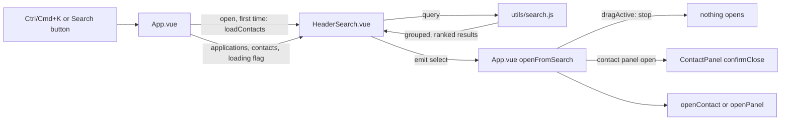

# Header Search - Plan

## Goal Capsule

- **Objective:** From any view in the tracker, the user can find a person or a role by typing part of a name, employer, company, title, email or phone number, and open that record within a few seconds, without leaving the view they are on.
- **Means:** A header search component that matches in the browser over the role and people lists the client already fetches (KTD1, KTD3).
- **Product authority:** The user (fergus). The wider search work in Linear project P-INT-1 "Job Tracker Search" (full-text notes, connections, agent search, record links) is not active scope here.
- **Authority order for conflicts:** Product Contract requirements win on behavior; Key Technical Decisions win on mechanism within them.
- **Stop conditions:** Stop and ask if meeting R13 needs a change to how ApplicationPanel or ContactPanel open or close beyond the two close hooks in KTD5, or if any server change looks necessary.
- **Execution profile:** Code, client only, one PR. The implementer finishes code, unit and E2E tests and the guide update; the user checks it on a real phone.
- **Open blockers:** None.

---

## Product Contract

### Summary

A search control lives in the header on every view. It matches people and roles as the user types, and picking a result opens the usual record panel over the current view. On desktop it is a visible field that Ctrl/Cmd+K focuses; on a phone it is a Search button that opens a full-width box.

### Problem Frame

The user was on the phone with someone and needed their record. There is no search anywhere in the app, so they used the browser's Ctrl+F and scanned the page. That only works when the right view is open and the person is already on screen, and it misses anything the view does not render, such as a phone number or email.

The People view deliberately has no filter control (`client/src/components/PeopleView.vue:103`), and Board, Timeline, People and Today share no way to find a record.

### Key Decisions

- **Names and identifiers first, full text later.** v1 covers people and roles on short fields only; notes, job descriptions and connections wait for the search index planned in P-INT-1. Governs R4, R5. (session-settled: user-approved — chosen over the full palette with Notes and Connections groups, paste-to-open and hash links: the smallest version that solves the mid-call lookup.)
- **Email and phone are searchable.** A caller's number or address is often what the user has in hand. Governs R6, R7. (session-settled: user-approved — chosen over name, employer and company only: those miss the lookup that started this work.)
- **Field on desktop, button on phone.** The desktop field is always visible so search needs one click; on a phone the header has no room, so a button opens a full-width box. Governs R1, R2. (session-settled: user-directed — chosen over a single shape everywhere, either an always-visible field, a centred overlay, or an icon that expands in place.)
- **Closed records are included, after open ones.** The person on the phone may belong to a role that ended. Governs R9. (session-settled: user-approved — chosen over hiding closed records unless the closed toggle is on.)

### Requirements

**Entry point**

- R1. On screens at or above the `sm` breakpoint, a search field is visible in the header on Today, Pipeline and People.
- R2. Below the `sm` breakpoint, the header shows a Search button that opens a full-width search box; its tap target is at least 44px.
- R3. Ctrl+K (Cmd+K on macOS) focuses the search field, or opens the phone box, from any view, including when a record panel is open.

**What it matches**

- R4. People match on name, employer, role, email and phone.
- R5. Roles and leads match on company and role title.
- R6. Matching ignores case, and a query matches anywhere inside a field.
- R7. Phone matching compares digits only and treats a number written with a leading 0 the same as that number written with its country code, so `0412 345 678`, `0412345678` and `+61 412 345 678` are interchangeable.
- R8. People are searchable from every view, including before the People view has been opened in the session.

**Results**

- R9. Results are grouped into People and Roles; within each group open records come first and closed records follow, labelled closed.
- R10. Each result shows enough to tell similar records apart: for a person, name plus employer or role; for a role, company plus title, and whether it is a lead.
- R11. When nothing matches, the results say so in one line.
- R12. Arrow keys move through results, Enter opens the highlighted one, and Escape clears and closes the results.

**Opening a record**

- R13. Picking a person opens the contact panel and picking a role opens the application panel, over the current view, without changing section.
- R14. Picking a result while a board card is being dragged does nothing.
- R15. After a record opens, the search box closes and its query is cleared.

### Key Flows

- F1. Mid-call lookup on desktop
  - **Trigger:** The phone rings; the user is on Today with a role panel open.
  - **Steps:** The user presses Ctrl+K (R3), types part of the caller's surname or number (R4, R7), sees the person under People (R9, R10), presses Enter (R12). The contact panel opens over the current view (R13) and the search closes (R15).
  - **Outcome:** Closing the contact panel returns the user to the role they had open.
- F2. Lookup on a phone
  - **Trigger:** The user is on the tracker on their phone.
  - **Steps:** The user taps Search (R2), types, taps a result, and the panel opens (R13, R15).

### Acceptance Examples

- AE1. **Covers R7.** Given a person stored with phone `+61 412 345 678`, when the user types `0412 345`, then that person appears under People.
- AE2. **Covers R8.** Given the user opened the app on Today and has not visited People, when they type a person's name, then that person appears.
- AE3. **Covers R9.** Given a closed role at Acme and an open lead at Acme, when the user types `acme`, then the lead is listed before the closed role and the closed role is labelled closed.
- AE4. **Covers R13.** Given the user is on Pipeline with a role panel open, when they pick a person, then the contact panel opens over the role panel and the section stays Pipeline.
- AE5. **Covers R14.** Given a board card is mid-drag, when the user presses Enter on a highlighted result, then nothing opens.
- AE6. **Covers R11.** Given no record matches `zzqx`, then the results show a single "no matches" line.

### Success Criteria

- With a role panel open on Today, the user can open a known person's record from a partial name or number in under five seconds, keyboard only on desktop.

### Scope Boundaries

Deferred for later (P-INT-1):

- Searching stage notes, interview notes, prep work, job descriptions, contact notes and attachment text.
- LinkedIn connections as a result group.
- Recent records or Today's due items in the empty state.
- Pasting a URL or email to jump straight to a record.
- Hash links (`#/app/12`, `#/contact/4`) and any routing layer.
- Filtering the Board, Timeline or People views by the query.
- Searching from the MCP server.

### Dependencies / Assumptions

- Contacts are not loaded at startup today; they load when People is opened (`client/src/App.vue:471`, onMounted at `client/src/App.vue:890-905`). KTD2 adds a load when search first opens.
- Phone numbers are stored as typed with no normalisation (`server/services/contacts.js:30`), so R7 normalises at match time.
- The record panels already open over any section (`openPanel`, `openContact` in `client/src/App.vue:532-554`), and the contact panel stacks over the application panel.
- The applications list the client holds includes closed records; `displayApplications` hides them only for display (`client/src/App.vue:296-299`).

### Sources / Research

- `docs/ideation/2026-06-25-search-capability-ideation.html` idea 4 (palette with record links); this plan takes its entry point and leaves the rest deferred.
- `docs/solutions/ui-bugs/showclosed-toggle-drag-guard-and-panel-close-sync-2026-04-30.md`: actions that change what is shown must check `dragActive` and close panels synchronously; applies to R14.
- Existing guards: `client/src/App.vue:291` (`dragActive`), `client/src/App.vue:315-317` (closed toggle guard).
- Closed state: `client/src/utils/timeline.js:28` (`isTerminal`).
- Header layout and breakpoints: `client/src/App.vue:11-96`; tap target pattern `min-h-[44px]` / `size-11`.
- No global keyboard listener exists today; the only document listener is `visibilitychange` (`client/src/App.vue:893`).

---

## Planning Contract

### Key Technical Decisions

- KTD1. **Match in the browser, no server change.** A pure module filters the `applications` and `contacts` arrays App.vue already holds. Both endpoints return whole lists, so results come back on every keystroke with no request, and the server's contact `query` does not match email or phone (`server/services/contacts.js:212-214`). Covers R4-R8.
- KTD2. **People load the first time search opens, then refresh on each open.** Role results show at once; the People group shows "Loading people..." until `loadContacts()` resolves. If the first load fails, the People group shows "Could not load people" with a Retry action instead of counting as empty, and an error toast shows as `refreshContacts()` does. Later opens show the held list straight away and refresh it in the background, because contacts are not on the live-update stream (`client/src/App.vue:876-877`). Covers R8. (session-settled: user-directed — chosen over loading people at app startup: no extra request at startup, at the cost of a short wait on the first search.)
- KTD3. **One component, two presentations.** `HeaderSearch.vue` renders an inline header field at `sm` and up. It renders a floating box teleported to `body` below `sm`, or whenever a record panel is open, because ApplicationPanel (`fixed inset-0 z-50`) and ContactPanel (`z-[55]`) cover the header. The floating box sits at `z-[58]`, above both record panels. The Settings panel is also `z-50` (its one-time key modal is `z-[60]`, `client/src/components/SettingsPanel.vue:612`), so KTD4 keeps search closed while Settings is open, and opening Settings closes search. Covers R1-R3. (session-settled: user-approved — chosen over closing open panels on Ctrl+K: the user keeps the record they had open.)
- KTD4. **Ctrl/Cmd+K is one document `keydown` listener in App.vue.** It calls `preventDefault`, opens or focuses search, and does nothing while `showSettings` is true. It is added in `onMounted` and removed in `onUnmounted`, next to the existing `visibilitychange` listener (`client/src/App.vue:893`). Covers R3. (session-settled: user-approved — chosen over letting Ctrl+K open search above Settings: Settings is a modal task, not a view.)
- KTD5. **Every pick goes through one App.vue function, `openFromSearch(result)`.** It returns early while `dragActive` is true. If a contact panel is open, it asks ContactPanel to close through the panel's existing unsaved-changes check (a `confirmClose()` exposed with `defineExpose` that returns whether closing may proceed) and stops if the user cancels. For a role pick while ApplicationPanel is open on a different record, it first runs that panel's own close path (exposed as an async `closeForSwitch()` that saves a typed note to the current record, shows the existing unsaved-changes prompt when the form or queued files are dirty, and resolves false if that prompt is showing) and stops on false. Switching the open panel in place is never used: the id watcher in `client/src/components/ApplicationPanel.vue:1244-1259` keeps `newNoteContent` and `queuedFiles` across records, so they would save against the new role. It then calls `openContact(id)`, or clears `contactId` and calls `openPanel(app)` for a role, so a role never opens underneath a contact drawer and a reopened panel mounts fresh. Covers R13-R15. (session-settled: user-approved — chosen over switching records silently: unsaved contact edits are never dropped.)
- KTD6. **Phone matching works on digits.** Phone matching runs only when the query holds 3 or more digits. Leading zeros are dropped from the query. When the query starts with `+` or `00`, the match also tries dropping 1, 2 and 3 leading digits as a possible country code. A person matches when any variant is a substring of their stored phone's digits. Covers R7. (session-settled: user-approved — chosen over matching from the first digit: one or two digits would match nearly every number.)
- KTD7. **Ranking and caps.** Text matching lowercases both sides and strips diacritics. Within each group, open records come before closed ones (per R9). Then matches whose name or company starts with the query come before other matches, then alphabetical order. Each group shows at most 8 results and a "N more, keep typing" line when it holds more. Covers R9-R11. (session-settled: user-approved — chosen over an uncapped list: the box stays scannable mid-call.)

### High-Level Technical Design

Component flow (directional, not a specification):

Which presentation shows (KTD3):

| Viewport | Record panel open | Presentation |
|---|---|---|
| `sm` and up | No | Inline header field; results drop down under it |
| `sm` and up | Yes | Floating box above the panel |
| Below `sm` | Either | Search button in the header; floating full-width box |

### Implementation Constraints

- Follow the drag-guard learning: an action that changes what is shown checks `dragActive` first and opens or closes panels synchronously, never in `nextTick` (`docs/solutions/ui-bugs/showclosed-toggle-drag-guard-and-panel-close-sync-2026-04-30.md`).
- Use the existing control styling: inline Tailwind utilities and tokens (`bg-raised`, `border-line`, `focus:ring-accent`, `text-ink-3`), as in the People input at `client/src/components/PeopleView.vue:29`. Tap targets use `min-h-[44px]` or `size-11`.
- The results use the ARIA combobox pattern: an input with `role="combobox"`, `aria-expanded`, `aria-controls` and `aria-activedescendant`, plus a `role="listbox"` of options.
- ASCII only in code and comments.

---

## Implementation Units

### U1. Matching module

- **Goal:** A pure function that takes a query plus the applications and contacts arrays and returns grouped, ranked, capped results.
- **Requirements:** R4-R7, R9-R11; KTD1, KTD6, KTD7.
- **Dependencies:** None.
- **Files:** `client/src/utils/search.js` (new), `client/src/utils/search.test.js` (new).
- **Approach:** Export one entry point that returns `{ people, roles }`. Each group holds the visible items and a hidden count. A person item carries name plus employer or role. A role item carries company, title, a lead flag and a closed flag (`isTerminal` from `client/src/utils/timeline.js:28`). An empty or whitespace query returns empty groups. Follow the style of the other pure modules in `client/src/utils/` (`contactGroups.js`: header comment, no Vue imports).
- **Test scenarios:**
  - `smi` matches contact "Jo Smith" by name, and a contact whose employer is "Smithfield".
  - `jo@acme` matches the contact with email `jo@acme.com`.
  - Phone stored `+61 412 345 678`: queries `0412 345` (AE1), `412345` and `+61 412` all match.
  - Phone stored `0412 345 678`: query `+61 412 345` matches.
  - Query `04` (2 digits) does not trigger phone matching.
  - `acme` with an open lead and a closed application at Acme returns the lead first and the closed one flagged closed (AE3).
  - A role matches on role title alone.
  - `Zoe` matches a contact stored as "Zoë".
  - Starts-with ranks above contains: `jo` puts "Jo Smith" above "Majo Lee".
  - 12 matching contacts return 8 visible and a hidden count of 4.
  - `zzqx` returns two empty groups (data side of AE6).
- **Verification:** `cd client && npm run test:unit` passes, including the new file.

### U2. HeaderSearch component

- **Goal:** The search UI in both presentations, with keyboard control, the loading state and the empty state.
- **Requirements:** R1, R2, R9-R12, R15; KTD2, KTD3, KTD7.
- **Dependencies:** U1.
- **Files:** `client/src/components/HeaderSearch.vue` (new).
- **Approach:**
  - Props: `applications`, `contacts`, `peopleLoading`, and `floating` (App.vue passes true when a record panel is open). Emits `open-search`, so App.vue can trigger the contact load, and `select` with the chosen result. Exposes `focus()` for the shortcut.
  - The phone Search button and the inline field render in the header with `sm:hidden` and `hidden sm:block`. The floating box renders through `<Teleport to="body">`, following `client/src/components/ToastContainer.vue:2`.
  - Arrow keys move through People results, then Roles results, wrapping at the ends. Enter emits `select` for the highlighted result. Escape clears the query, closes the results and returns focus to whatever had it before the box opened. Choosing a result also clears and closes (R15).
  - The People group shows "Loading people..." while `peopleLoading` is true and no contacts are held, and "Could not load people" with a Retry button (re-emits `open-search`) when the load failed and none are held. When both groups are empty, nothing is loading and no load failed, one "No matches" line shows (R11).
  - The floating box has a Close button with a 44px tap target, and a click or tap outside it closes it. The inline field closes its results when it loses focus to anything outside them. Every dismissal clears the query, as Escape does. Closed and lead tags use the muted `text-ink-3` style.
  - Results re-run when `contacts` or `applications` change while the box is open.
- **Test scenarios:** Covered in the browser by U4. The component holds UI state only; the matching it relies on is unit-tested in U1.
- **Verification:** `cd client && npm run lint` is clean.

### U3. App.vue wiring and ContactPanel close hook

- **Goal:** Place the search in the header, add the shortcut and the first-open contact load, and route every pick through the guarded open function.
- **Requirements:** R3, R8, R11, R13, R14; KTD2, KTD4, KTD5.
- **Dependencies:** U2.
- **Files:** `client/src/App.vue`, `client/src/components/ContactPanel.vue`, `client/src/components/ApplicationPanel.vue`, `docs/guide/using.md`.
- **Approach:**
  - Mount `HeaderSearch` at the start of the right-hand header cluster (`client/src/App.vue:39`), before the closed toggle. Give the inline field a width that grows at `md` and `lg` so the header still wraps cleanly.
  - Track whether contacts have ever loaded, setting the flag only when `loadContacts()` returns true. On `open-search`, show the loading state only if they never have, then call `loadContacts()` either way and always clear the loading state afterwards. Pass a load-failed flag to HeaderSearch (KTD2).
  - Add the keydown listener (KTD4) and `openFromSearch` (KTD5).
  - In ContactPanel, expose `confirmClose()`, which reuses the dirty check in `requestClose` (`client/src/components/ContactPanel.vue:464-467`) without emitting. In ApplicationPanel, expose `closeForSwitch()`, which wraps the existing `close()` (`client/src/components/ApplicationPanel.vue:1290-1299`) and resolves once the panel has closed, or false when `pendingClose` is showing. Hold template refs to both panels in App.vue.
  - Add a short "Finding a record" paragraph to `docs/guide/using.md` covering the header search and Ctrl/Cmd+K.
- **Test scenarios:** Covered in the browser by U4.
- **Verification:** `cd client && npm run lint` is clean, and `npm run build:client` succeeds.

### U4. Browser tests

- **Goal:** Prove the requirements end to end in a real browser.
- **Requirements:** R1-R3, R8, R11-R15; AE2, AE4, AE5, AE6; F1, F2.
- **Dependencies:** U3.
- **Files:** `client/e2e/search.spec.js` (new); reuse `seedApp` and `gotoPipeline` from `client/e2e/helpers.js`.
- **Approach:** Seed records through the API as `client/e2e/contact-panel.spec.js:13` does, with unique names per test so specs do not collide. Hold a card mid-drag the way `client/e2e/kanban-drag.spec.js` does. A native drag may stop keyboard events reaching the page; if Enter cannot be delivered mid-drag, assert the guard by triggering the pick with a click on the result while `dragActive` is held, and note the substitution in the test.
- **Test scenarios:**
  - On Today, without visiting People, typing a seeded contact's name lists them, and Enter opens their contact panel (AE2, F1).
  - On Pipeline, Ctrl+K focuses the inline field; Enter on a role opens the application panel and the section stays Pipeline.
  - With a role panel open, Ctrl+K opens the floating box. Picking a person opens the contact panel over the role panel, and closing it shows the role panel again (AE4).
  - With unsaved edits in a contact panel, picking a role shows the unsaved-changes dialog. Dismissing it leaves the contact panel open, and no role panel opens.
  - With role A open and an edited role title, picking role B shows A's unsaved-changes prompt and B does not open. With only a typed note in A, picking B saves the note to A and opens B with an empty note box.
  - With the contacts request forced to fail (Playwright route), opening search shows "Could not load people" rather than "No matches".
  - On a phone viewport, the Close button closes the box.
  - Mid-drag on the board, pressing Enter on a highlighted result opens nothing (AE5).
  - `zzqx` shows a single "No matches" line (AE6).
  - Escape clears the query and closes the results.
  - Arrow Down then Enter opens the second result.
  - At a 390px-wide viewport the Search button is visible and the inline field is not. Tapping the button opens the full-width box, and picking a result opens the panel (F2).
  - Ctrl+K while Settings is open does nothing.
- **Verification:** `npm run build:client && cd client && npm run test:e2e` passes.

---

## Verification Contract

- Unit: `cd client && npm run test:unit`.
- Lint: `cd client && npm run lint`.
- E2E: `npm run build:client && cd client && npm run test:e2e`.
- Backend: `cd server && npm test` still passes; no server files change.
- Manual, by the user: on a phone, tap Search, find a person by part of their number, and open them.

## Definition of Done

- U1-U4 are complete, and every command in the Verification Contract passes.
- Every Acceptance Example is covered by a passing unit or E2E test.
- No server file changed.
- `docs/guide/using.md` mentions the search and its shortcut.
- No dead or experimental code from abandoned attempts remains in the diff.
