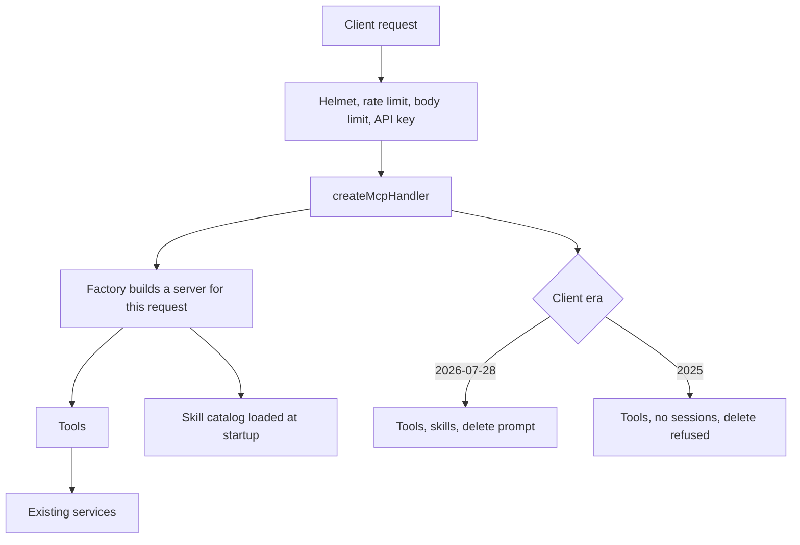
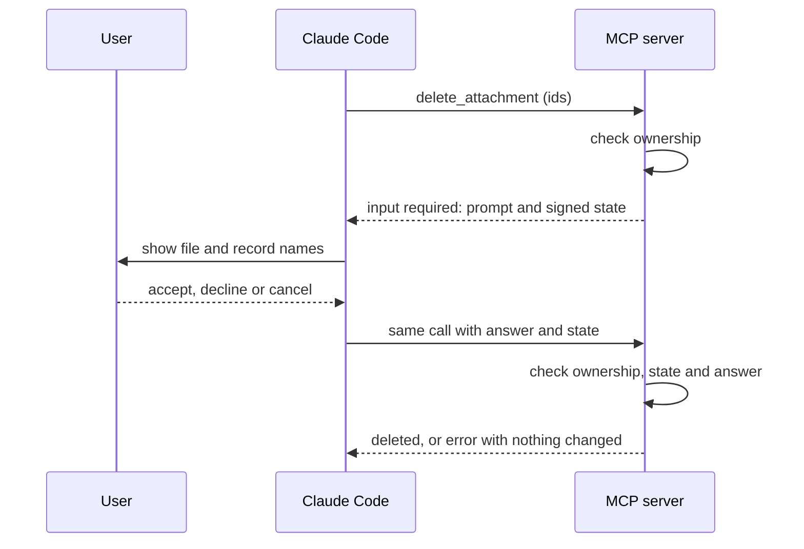

# MCP Skills - Plan

## Goal Capsule

- **Objective:** In Claude Code, the user can find people and roles, keep notes, manage attachments and see what needs doing, without having to explain the tracker's rules to Claude.
- **Means:** Move the MCP server to the 2026-07-28 specification on TypeScript SDK v2 (KTD1, KTD2) and ship four skills from it, with the three tool changes those skills need.
- **Product authority:** The user (fergus). This plan owns skills only. The other areas in How This Work Fits Together are not active scope.
- **Authority:** The Product Contract wins on product behavior. The Planning Contract wins on implementation mechanism.
- **Stop conditions:** Stop and report to the user if the U2 checkpoint fails, or if meeting R2 would change an existing tool's name, arguments or results beyond R8.
- **Execution profile:** One pull request. U1 lands as its own commit before any migration change.
- **Who finishes:** The implementer delivers the pull request. Merge, release, deploy and the post-deploy proxy check each need the user's go-ahead.
- **Open blockers:** None.

---

## Product Contract

**Product Contract preservation:** changed R1 (older clients are now served too, as decided during planning), R2 and R7 (wording follows the new R12), changed R6 (files on disk now use the upload URL, as decided after document review), added R12 and AE6, replaced the hard cut-over Key Decision, added the Today tool Key Decision, and updated Summary, Scope Boundaries and Outstanding Questions to match. File Uploads moved from a non-goal to deferred for later. All other requirements and IDs are unchanged.

### Summary

The job-tracker MCP server moves to the 2026-07-28 specification, keeps serving older clients, and publishes four skills: search, notes, attachments and actions.
It also gains role search by title, a read-only Today tool and a confirmed attachment delete, so each skill has a tool to call.

### Problem Frame

The user works the tracker from Claude Code in the terminal.
The recurring jobs are searching for contacts and roles, creating and updating notes, adding and removing attachments, and listing overdue and pending actions.

Guidance for these jobs lives in tool descriptions and in `AGENTS.md`, and the server offers no task-level playbook.
Two jobs also have gaps in the tools.
Role search matches company name only, so a role cannot be found by its title.
No MCP tool removes an attachment, although the browser can.

Claude Code loads skills from an MCP server only when the server speaks the 2026-07-28 revision.
The current server uses the older stateful transport.

### Key Decisions

- **Skills are the focus of this work.** They were chosen from three agent-experience areas. Governs R3, R4, R5, R6, R7. (session-settled: user-approved — chosen over tasks, confirmation prompts and a foundation-only plan: the tracker's guidance is already written as prose, so skills are where an agent gains most.)
- **Serve old and new clients.** The SDK serves both by default, so keeping older clients costs little. Governs R1. (session-settled: user-approved — chosen over a hard cut-over: the cut-over was first picked on the wrong belief that serving both was extra work.)
- **One skill per recurring job.** Claude loads a skill only when it is needed, so four narrow skills keep unrelated guidance out of context. Governs R3.
- **Files on disk go through the upload URL.** Direct upload needs Claude to retype the file as encoded text, and the server cannot tell if it arrived intact. Governs R6. (session-settled: user-approved — chosen over routing by file size: a damaged file could be saved and reported as a success.)
- **Add an attachment delete tool.** Governs R9. (session-settled: user-directed — chosen over a skill that only adds files, and over a hide-style delete: removal is one of the recurring jobs.)
- **The server asks for delete confirmation.** The delete is permanent, and the gate has to hold when no skill is loaded. Governs R10. (session-settled: user-approved — chosen over a skill instruction alone and over relying on Claude Code's tool permissions: both can be bypassed.)
- **Role search becomes a query on the existing list tool.** Governs R8. (session-settled: user-approved — chosen over a skill-side workaround and over searching note text: the workaround wastes context and note search is a larger change.)
- **The actions list follows the Today screen.** Governs R7. (session-settled: user-approved — chosen over overdue and due only, and over roles only: it matches what the user already reads.)
- **Add a Today tool.** It reverses the "no separate follow-ups tool" note in `AGENTS.md`. Governs R7, R12. (session-settled: user-approved — chosen over composing the existing list tools: the server already builds this list in the right order.)

### Requirements

**Protocol**

- R1. The MCP server speaks the 2026-07-28 specification and still serves tools to 2025-era clients, without sessions. Skills are promised only to clients on the new revision.
- R2. The 29 existing tools keep their names, arguments, results, API-key authentication and per-user scoping, apart from the added argument in R8.

**Skills**

- R3. The server publishes four skills through the MCP Skills extension (`io.modelcontextprotocol/skills`): search, notes, attachments and actions. Every user gets the same four.
- R4. The search skill finds people and roles for one request, using contact search and the role query in R8.
- R5. The notes skill creates and updates notes on roles and contacts. It states how the two update tools differ and that a note delete is a hide with no undo, as set out under "Correcting and withdrawing notes" in `AGENTS.md`.
- R6. The attachments skill adds any file on disk through the one-time upload URL, whatever its size, uses direct upload only when no HTTP upload can run, and removes attachments with the tool in R9.
- R7. The actions skill returns one list of the caller's overdue, due and next-seven-days actions from open roles and contacts, using the tool in R12.

**Tool changes**

- R8. `list_applications` accepts a free-text query that partially matches company name or role title.
- R9. A new `delete_attachment` tool permanently removes one attachment from the caller's own record, with the same effect as the browser delete, and is audited.
- R10. Before deleting, the server asks the user to confirm through MCP elicitation, naming the file and the record. Nothing is deleted if the user declines or cancels, or if the client cannot show the prompt.

- R12. A new read-only `get_today` tool returns the caller's own Today queue, with the same membership and order as the Today screen (`AGENTS.md`, API Conventions).

**Documentation**

- R11. `docs/guide/mcp.md` and `AGENTS.md` describe the new revision, the four skills and the three tool changes.

### Acceptance Examples

- AE1. **Covers R10.** Given an attachment on the user's record, when Claude calls `delete_attachment` and the user declines the prompt, then the file and its record are unchanged.
- AE2. **Covers R10.** Given a client that cannot show an elicitation prompt, when it calls `delete_attachment`, then the call fails and nothing is deleted.
- AE3. **Covers R9.** Given another user's attachment, when the user tries to delete it, then the response is "not found" and does not reveal that it exists.
- AE4. **Covers R4, R8.** Given a role titled "Staff Engineer", when the user asks Claude to find the staff engineer role, then the search returns it although the query does not match the company name.
- AE5. **Covers R7, R12.** Given a contact action due in 5 days, another due in 10 days, and a closed role that still has a re-check date, when the user asks for pending actions, then only the 5-day contact action appears.
- AE6. **Covers R1, R2.** Given a 2025-era client, when it initializes, lists tools and calls one, then it gets the same result as before the move.

### Success Criteria

- In Claude Code in the terminal, all four skills are listed for the job-tracker server.
- Each of the four recurring jobs completes without the user explaining which tool to use or how it behaves.

### Scope Boundaries

- Running slow tools as MCP tasks.
- Confirmation prompts on any tool other than `delete_attachment`.
- MCP Apps, tool annotations and output schemas.
- Per-user or generated skills.
- Search over note text, job descriptions or attachment text.
- Skills in `claude -p`, the Agent SDK, cloud sessions and GitHub Actions, where Claude Code does not load MCP skills.

#### Deferred for later

- **MCP File Uploads for attachments** (`io.modelcontextprotocol/files`). Kept as an idea for a future iteration. As of 2026-11-25 it is experimental, and Claude transfers files only for connectors listed in the Connectors Directory, so a self-hosted server added by URL cannot use it. Revisit if that changes. `upload_attachment` and `get_upload_url` stay as they are.

<!-- ce-section: work-relationships -->
### How This Work Fits Together

This plan covers MCP skills.
The breakdown below is the current understanding, not a committed roadmap.

- **Tasks for slow tools** (`generate_document`, `fetch_job_description`)
  - Shares the move to the new revision.
  - Still to decide: whether it is worth doing.
- **Confirmation prompts on other irreversible tools**
  - Shares the confirmation mechanism introduced by R10.
  - Still to decide: which tools need it.
- **Wider job-tracker search** (Linear project P-INT-1)
  - Can proceed independently of this plan.
  - Shares role search: R8 is a small agent-search step, and the header search plan (`docs/plans/2026-11-09-0639-feat-header-search-plan.md`) leaves MCP search out of its scope.

### Dependencies / Assumptions

- The only client of the MCP server is Claude Code in the terminal, as stated by the user.
- Claude Code must be v2.1.331 or later. The development machine has 2.1.332.
- MCP skills are a public beta. Claude Code also requires a supported model, a direct connection to Anthropic, and an eligible login. Skills are currently off for API-key and Console logins. The user's login type has not been checked.
- The public `/mcp` URL goes through a reverse proxy outside this repository. It is assumed to pass the new request headers through; this has not been checked.

### Sources / Research

- [MCP 2026-07-28 changelog](https://modelcontextprotocol.io/specification/2026-07-28/changelog): removes the `initialize` handshake and sessions, adds `server/discover`, and requires new request headers and result fields.
- [Skills extension overview](https://modelcontextprotocol.io/extensions/skills/overview): skills are resources with a `SKILL.md`, and the server implements `skills/list` and `skills/get`.
- [Claude Code MCP docs](https://code.claude.com/docs/en/mcp): "Use skills from MCP servers" lists version, model, login and surface requirements.
- [MCP servers can now ship skills, run tasks, and more with Claude](https://claude.com/resources/articles/skills-over-mcp-tasks-and-more): the article that framed the candidate areas.
- [TypeScript SDK](https://github.com/modelcontextprotocol/typescript-sdk): v2 packages implement the new revision. The installed `@modelcontextprotocol/sdk` 1.32.2 is the v1 line.
- Published type declarations of `@modelcontextprotocol/server` 2.4.0, `core` 2.4.0 and `node` 2.1.2, read on 2026-11-25 without running them. They show CommonJS exports, a Node >=20 engine, a zod ^4.2.0 range, `createMcpHandler` with a stateless legacy default, `registerTool`, auth at `ctx.http.authInfo`, `inputRequired`, `createRequestStateCodec`, and `loadSkills` in `@modelcontextprotocol/server/ext/skills/node`.
- [File uploads for connectors](https://claude.com/docs/connectors/building/files) and the [experimental extension repository](https://github.com/modelcontextprotocol/experimental-ext-file-uploads): basis for the deferral above.
- `server/mcp.js`: registers tools only. The `sessions` map holds transports, and no tool reads it.
- `server/routes/applications.js`: the browser attachment delete removes the row and the file, writes an audit event and keeps no backup.
- `server/services/audit.js`: tools missing from `READ_ONLY_TOOLS` are audited as changes.

---

## Planning Contract

### Key Technical Decisions

- KTD1. **Replace the v1 SDK with SDK v2 and stay on CommonJS.** Use `@modelcontextprotocol/server` ^2.4.0 and `@modelcontextprotocol/node` ^2.1.2, and remove `@modelcontextprotocol/sdk`. The v2 server packages publish CommonJS builds, accept the repo's zod version and include the Skills extension. Add `@modelcontextprotocol/client` ^2.4.0 as a dev dependency for new-revision tests, so they do not rest on hand-built requests. Its package metadata lists CommonJS exports and a Node >=20 engine. 2025-era tests keep the raw HTTP helper.
- KTD2. **One server per request, with the SDK's stateless legacy mode.** `createMcpHandler` calls `createMcpServer` for each request, and `toNodeHandler` receives the already parsed `req.body`. The `sessions` map goes; no tool reads it. Helmet, the rate limit, the 100 KB body limit and API-key auth stay in front, in their current order. `GET` and `DELETE` now return 405. A new-revision `subscriptions/listen` stream stays open, so shutdown must call the MCP handler's `close()` before waiting for the HTTP server to close. `startMcpServer` ties that into the server it returns, or exposes it to `server/index.js`. Serves R1. (session-settled: user-approved — chosen over a hard cut-over: the SDK serves both by default.)
- KTD3. **Adapt tool registration in one place.** A local helper in `createMcpServer` replaces the patched `server.tool`, calls `registerTool`, and passes handlers `authInfo` (from `ctx.http.authInfo`) and `mcpReq`. Existing handler bodies keep reading `extra.authInfo`, so the 29 call sites change as little as possible. The helper writes no audit event for an error result or an input-required result.
- KTD4. **Skills are files, loaded strictly before the server listens.** Each skill is `server/skills/<name>/SKILL.md`, loaded once with `loadSkills` in strict mode and attached to every per-request server. `startMcpServer` still returns the HTTP server at once and calls `listen` after the load. A load failure is raised as a server error, so a broken skill stops startup. `createMcpServer` takes the catalog as an optional argument. Keep the SDK's default cache hint. Serves R3.
- KTD5. **Confirm the delete in two rounds with signed request state.** Serves R9, R10. (session-settled: user-approved — chosen over a skill instruction and over Claude Code's tool permissions: both can be bypassed.)
  - The arguments are `application_id` and `attachment_id`, as in `get_attachment_text`.
  - Every round first checks that the caller owns the record and that the attachment is on it.
  - Filenames need not be unique, so the prompt shows the filename, company, role title, file size, upload time and attachment ID.
  - With no request state, the tool asks and deletes nothing, even if the call already carries a response.
  - The state comes from `createRequestStateCodec`: a random key per process, a five-minute lifetime, bound to the user, and verified through `ServerOptions.requestState.verify`. It holds only the two IDs, because it is signed and not encrypted.
  - The delete runs only when the state verifies, its IDs match the arguments, and the answer is accept with an explicit true confirmation.
  - Decline, cancel and a false confirmation return an error result, so no delete is audited.
  - A 2025-era request is refused before any prompt, using the factory's `era` value. The stateless path cannot deliver one.
  - For new-revision clients that do not declare elicitation, the SDK is expected to return error `-32021`. U5 must prove it.
  - A restart voids pending approvals, so the user is asked again. A replayed approval finds nothing, because attachment IDs use `AUTOINCREMENT` and are not reused.
- KTD6. **One delete service for browser and agent.** `deleteAttachment` in `server/services/applications.js` is owner-only and covers the row, the `updated_at` bump, the file and the change event. The REST route calls it and keeps its status codes and messages. Each caller keeps its own audit write. The MCP audit details are the attachment ID and filename.
- KTD7. **`get_today` is a thin wrapper.** It takes no arguments, calls `listToday` for the caller without the admin `all` option, and returns `{items}`. Add it to `READ_ONLY_TOOLS`. Serves R12. (session-settled: user-approved — chosen over composing the list tools.)
- KTD8. **Role search is one service filter.** `listApplications` takes `query`, matches company name or role title, and combines with the other filters by AND. It treats wildcards the same way `company_name` does. The REST route names the fields it forwards and does not forward `query`, so REST is unchanged. Serves R8.

### High-Level Technical Design

These diagrams show direction, not code.

The delete confirmation on the new revision:

### Risks

| Risk | Response |
|---|---|
| SDK v2 has only been read, never run. | U2 is a thin end-to-end slice, with a checkpoint before more work. |
| The delete design fails if Claude Code cannot complete the confirmation round trip. | The U2 checkpoint proves it before U5 is built. |
| MCP skills are a public beta, and eligibility depends on login type. | The U2 checkpoint proves a skill loads in the user's own Claude Code. |
| A schema or result changes during the SDK move. | U1 records current behavior first. |
| The external `/mcp` proxy may drop the new headers. | Check it right after deploy. Roll back to the previous image if it fails. |
| The 405 on `GET` breaks the existing rate-limit test's expected status. | U2 updates the expected status only; the 429 assertion stays. |
| New-revision connections may make more requests against the 60-per-minute limit. | Watch for 429 responses during the live check. Change the limit only if one appears. |

### Open Questions (deferred to implementation)

- The exact schema of the confirmation field, based on how Claude Code renders it.
- How SDK v2 stores its registered tools, which `server/test/mcp.test.js` reads through a private field.

---

## Implementation Units

### U1. Record current MCP behavior

- **Goal:** A baseline that fails if the SDK move changes anything a client sees.
- **Requirements:** R2, AE6.
- **Dependencies:** None.
- **Files:** `server/test/mcp-contract.test.js`, `server/test/fixtures/mcp-tools.json`, `server/test/api.test.js` (REST attachment delete coverage).
- **Approach:** Drive the current server over HTTP, following the `rpc` helper in `server/test/api.test.js`. Compare each tool's name, description, argument names, types, required list, enums and bounds. Normalize schema wrapper keys that the SDK controls. Keep the helper's handshake in one place, because U2 changes it.
- **Execution note:** Characterization first. These tests pass on the v1 SDK before any other change.
- **Test scenarios:**
  - `tools/list` returns exactly the 29 recorded tools and their argument shapes.
  - Representative calls succeed for applications, stage notes, contacts, contact notes, connections, attachments and profile, including a tool with no arguments.
  - Another user's record returns the same not-found result as today.
  - A schema-invalid argument returns an error result that names the tool and the argument, and writes nothing. Do not assert the SDK's own wording, which differs in v2 and falls outside R2 and the stop condition.
  - A legacy `status` argument fails with the app's current message, asserted exactly.
  - `generate_document`, `extract_job_description` and `fetch_job_description` are covered by failure paths that make no outside request.
  - With the model call faked locally, a successful `generate_document` returns the text and its extra top-level `attachmentMetadata` field. SDK v2's handling of that field is unverified.
  - A mutating call writes one audit event; a read-only call and a failed call write none.
  - REST attachment delete removes the row and file, bumps `updated_at`, audits once, and returns 404 for another user.
- **Verification:** `npm test` passes in `server/` with no production code changed.

### U2. Move to SDK v2 and serve one skill

- **Goal:** Both client eras work, and Claude Code loads one real skill.
- **Requirements:** R1, R2, R3, R5, AE6.
- **Dependencies:** U1.
- **Files:** `server/package.json`, `server/package-lock.json`, `server/mcp.js`, `server/index.js`, `server/skills/notes/SKILL.md`, `server/test/mcp.test.js`, `server/test/api.test.js`, `server/test/mcp-contract.test.js`, `server/test/mcp-skills.test.js`.
- **Approach:** Apply KTD1-KTD4. The notes skill comes first because it needs no new tool. Check that `server/index.js` still shuts down cleanly (`docs/solutions/workflow-issues/graceful-shutdown-sigterm-sigint-2026-04-23.md`).
- **Test scenarios:**
  - The U1 baseline passes; only the handshake helper changes.
  - A 2025-era client initializes, lists tools and calls one with no session ID.
  - A new-revision client discovers the server, lists tools and calls one as the right user.
  - Missing and invalid API keys get 401 for both eras.
  - Concurrent calls from two users each see only their own records.
  - `skills/list` returns `notes`, and its `SKILL.md` can be read.
  - A malformed skill in a temporary folder makes the load fail.
  - `GET` returns 405, the rate limit still returns 429, and an oversized body still returns 413.
  - With a `subscriptions/listen` stream open, MCP shutdown finishes well inside the 10-second fallback in `server/index.js`.
- **Verification:** Tests and lint pass. **Checkpoint:** with a local server, the user's Claude Code (v2.1.331 or later) lists `job-tracker:notes` and calls a tool. It also shows a confirmation prompt from a temporary probe tool that changes nothing, and the answer and request state come back to the server. Remove the probe before committing. Record the login type used. U3 onward waits for this.

### U3. Find roles by title

- **Goal:** `list_applications` finds a role by company or title.
- **Requirements:** R8, AE4.
- **Dependencies:** U2.
- **Files:** `server/services/applications.js`, `server/mcp.js`, `server/test/mcp.test.js`, `server/test/fixtures/mcp-tools.json`.
- **Approach:** KTD8.
- **Test scenarios:**
  - A query for part of a title finds "Staff Engineer" although the company name does not match.
  - A query for part of a company name finds its roles, whatever the letter case.
  - With `state: "open"`, a matching closed role is excluded, and `total` counts only matches.
  - Another user's matching role never appears.
  - Omitting `query` gives the recorded results.
  - REST list with `?query=` returns the same results as without it.
- **Verification:** The only baseline change is the new argument and its description.

### U4. Add the Today tool

- **Goal:** One call returns what needs doing.
- **Requirements:** R12, R7, AE5.
- **Dependencies:** U2.
- **Files:** `server/mcp.js`, `server/services/audit.js`, `server/test/mcp.test.js`, `server/test/fixtures/mcp-tools.json`.
- **Approach:** KTD7. Point the `list_applications` description's "what needs chasing" advice at `get_today` where it means the Today screen.
- **Test scenarios:**
  - A contact due in 5 days appears; one due in 10 days and a closed role with a re-check date do not.
  - Overdue, due and upcoming items match `listToday` in order.
  - Another user's items never appear, including when the caller is an admin.
  - An empty queue returns an empty list.
  - A call writes no audit event.
- **Verification:** The only baseline changes are the new tool and the edited description.

### U5. Delete attachments with confirmation

- **Goal:** An agent can permanently remove an attachment, only after the user approves that file.
- **Requirements:** R9, R10, AE1, AE2, AE3.
- **Dependencies:** U1, U2.
- **Files:** `server/services/applications.js`, `server/routes/applications.js`, `server/mcp.js`, `server/test/mcp-delete-attachment.test.js`, `server/test/fixtures/mcp-tools.json`.
- **Approach:** KTD6 first, with the U1 REST tests unchanged, then KTD5 using the KTD3 audit rule.
- **Execution note:** Test first. Run every refusal scenario over HTTP, so the SDK's own capability checks are exercised.
- **Test scenarios:**
  - The first call returns a prompt with the KTD5 details; the row and file remain and nothing is audited.
  - Two attachments with the same filename on one record get distinguishable prompts, and accepting one removes only that one.
  - Accept with true confirmation removes the row and file, bumps `updated_at`, and writes one audit event.
  - Decline, cancel and false confirmation change nothing and write no audit event.
  - A forged answer with no state only produces a prompt.
  - Altered or expired state, another user's state, and state for a different attachment all delete nothing.
  - Replaying an approval after the delete returns not found.
  - A new-revision client without elicitation gets an error and nothing is deleted.
  - A 2025-era client, with or without declared elicitation, gets an error promptly and nothing is deleted.
  - Another user's record or attachment returns not found, with no prompt.
- **Verification:** All refusal cases leave the row and file in place.

### U6. Write the remaining skills

- **Goal:** All four recurring jobs have accurate guidance.
- **Requirements:** R3, R4, R5, R6, R7.
- **Dependencies:** U3, U4, U5.
- **Files:** `server/skills/search/SKILL.md`, `server/skills/attachments/SKILL.md`, `server/skills/actions/SKILL.md`, `server/skills/notes/SKILL.md`, `server/test/mcp-skills.test.js`.
- **Approach:** Each `description` states when to use the skill, in the user's words. Each body covers only its own job and the rules a tool list does not make obvious.
  - Search: contact search plus the KTD8 query.
  - Notes: the differences R5 names.
  - Attachments: for a file on disk, `get_upload_url` and curl, even where the `upload_attachment` description suggests size alone; `upload_attachment` only when no HTTP upload can run; list before deleting; leave confirmation to the server's prompt.
  - Actions: `get_today`, keeping the server's order.
- **Test scenarios:**
  - `skills/list` returns exactly the four names, each with a description.
  - Two users get identical skills.
  - Every tool name mentioned in a skill exists in `tools/list`.
- **Verification:** Tests pass, and each skill is read against the tool descriptions it relies on.

### U7. Update the documentation

- **Goal:** The guide and `AGENTS.md` match the server.
- **Requirements:** R11.
- **Dependencies:** U6.
- **Files:** `docs/guide/mcp.md`, `AGENTS.md`.
- **Approach:** Cover the SDK packages, both client eras, the four skills and their Claude Code requirements, the three tool changes, and the delete refusal for older clients. Replace both statements that there is no separate Today or follow-ups tool.
- **Test expectation:** none -- documentation only.
- **Verification:** A search of both files finds no stale statement about sessions, the v1 package or a missing Today tool.

---

## Verification Contract

| Gate | How | Applies to |
|---|---|---|
| Server tests | `npm test` in `server/` | U1-U6 |
| Server lint | `npm run lint` in `server/` | U2-U6 |
| Image contents | Build the Docker image and confirm all four `SKILL.md` files exist under `/app/server/skills/`. `.dockerignore` excludes `*.md`, so check rather than assume. | U6 |
| Container start | The built image starts, the MCP port answers, and `docker stop` exits cleanly | U2, U6 |
| Claude Code, local | `PUBLIC_URL` points at the local app, so upload URLs work. An uploaded test file has the same size as the original. All four skills are listed. Each recurring job completes without naming a tool. The delete prompt appears; decline keeps the file and accept removes it. Use test data. | Before merge |
| Claude Code, public URL | The same connection through the `/mcp` proxy lists the skills, calls a tool and shows the delete prompt. Use a disposable attachment. | After a deploy the user approves |

CI runs tests and lint on Node 26. The development machine has Node 22.

## Definition of Done

- R1-R12 are met and AE1-AE6 pass as tests, apart from skill-driven behavior, which the live check covers.
- Every Verification Contract gate has passed. A gate that was not run is reported as not run.
- Each unit's verification line holds.
- `@modelcontextprotocol/sdk` is no longer a dependency or imported anywhere.
- The diff holds no abandoned experiments, debug output or unused code from the session map.
- The pull request states that the public URL check is still pending until after deploy. The work is complete only when it passes.
